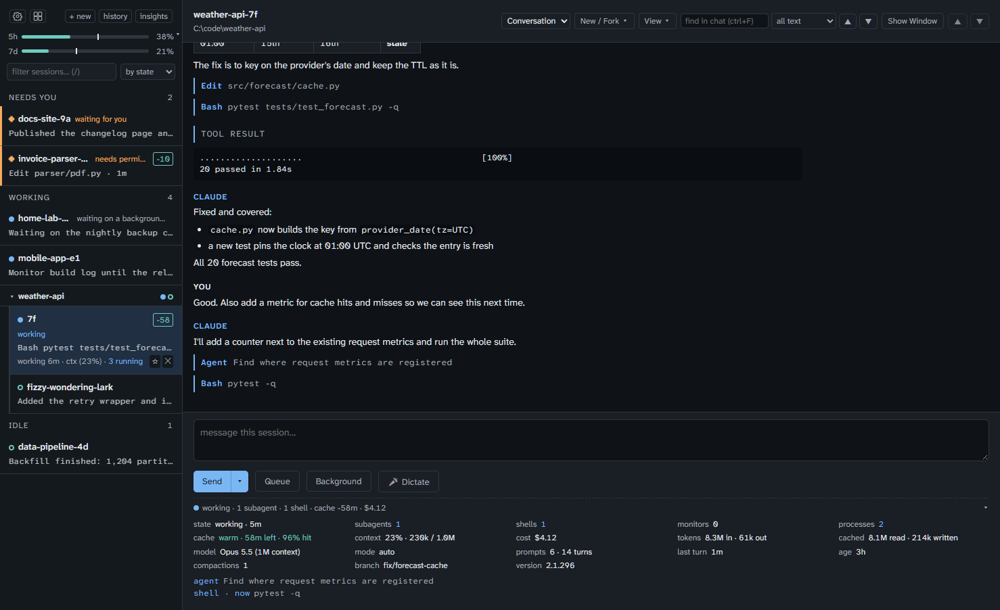
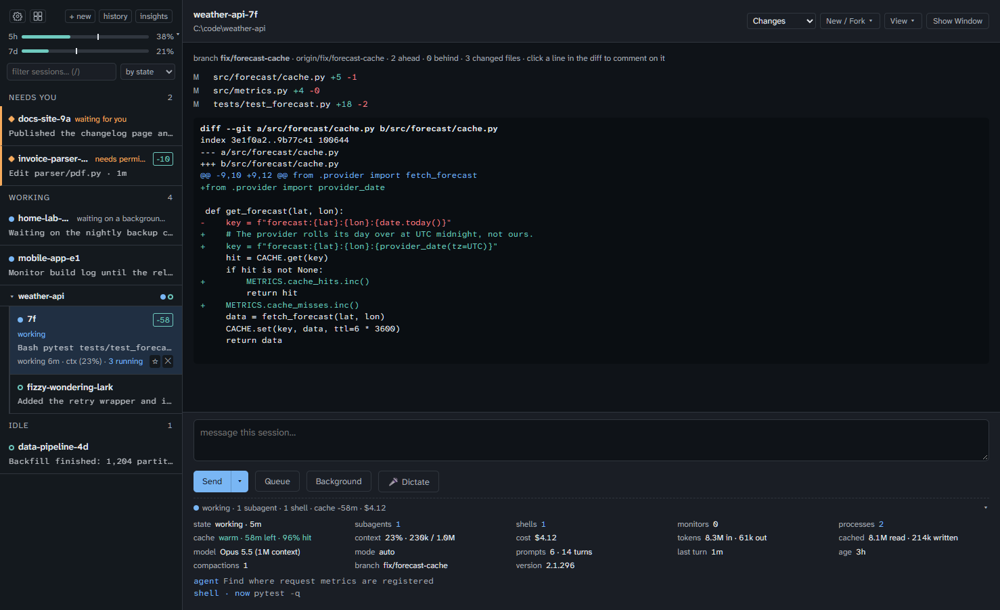
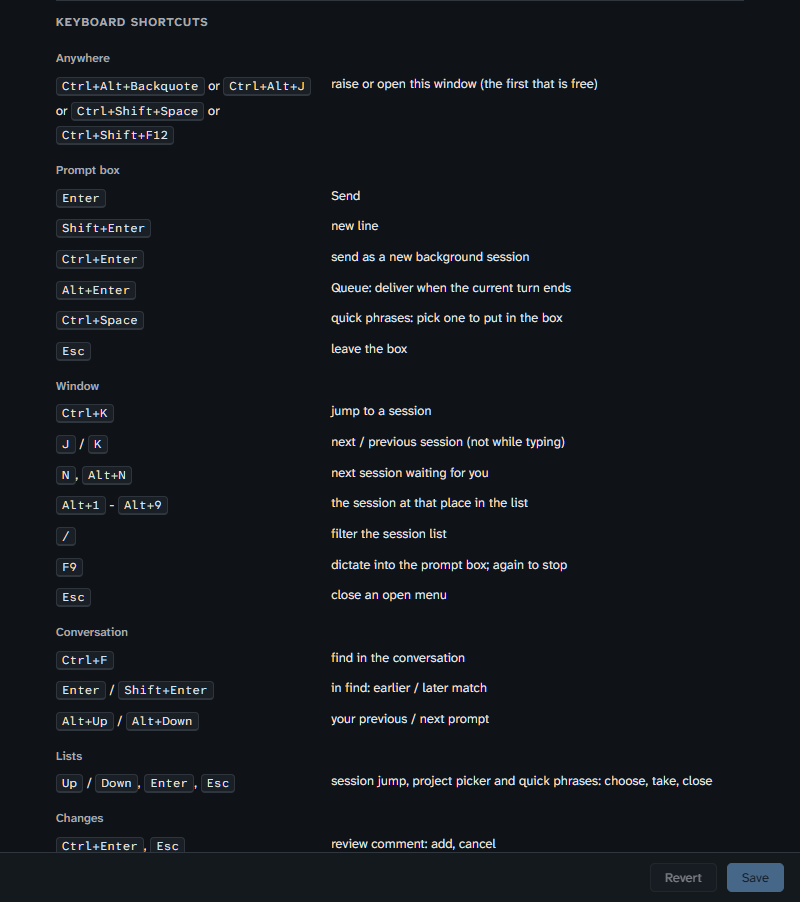
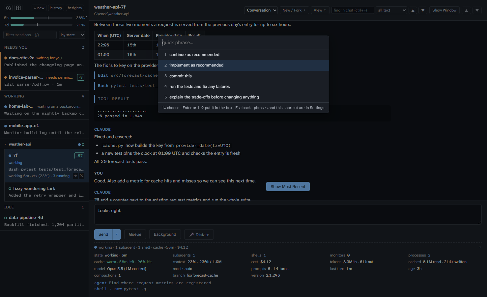
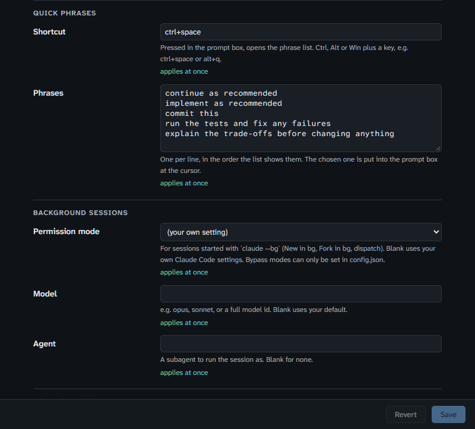

# Imperatorium

One place to see every Claude Code session on this machine and the machines
you reach over SSH, and one way to send work to any of them without hunting
for its window.

Built for a desk running ~20 concurrent sessions across separate repositories,
spread over several Windows virtual desktops. The premise is that *finding the
window* is a symptom, not the problem: if you can dispatch without visiting a
session, and be told when one actually wants you, most of the hunting stops
being necessary.



*Sessions down the left, grouped by what they need from you; the selected session's conversation, prompt box and status panel on the right. (Demo data.)*

New here? The [introduction site](https://hypertetrahedron.github.io/imperatorium/)
walks through what Imperatorium does, area by area. This README is the full
reference.

## Install

You need [Claude Code](https://claude.com/claude-code) 2.1.234+ (2.1.224 on
macOS/Linux) and git. Claude Code 2.1.287+ adds
[the Imperatorium mod](#the-imperatorium-mod), which setup offers when it
finds that version. `gh`, Windows Terminal and Edge are optional; each
switches a feature on (PR badges, Resume/Fork tabs, a chromeless window).
Imperatorium itself is one Rust binary, `imperatorium`, with nothing else to
install: no Python, no virtualenv. The last version with a Python
implementation is the tag `last-python`. For a Claude Code without mods,
[v0.1.0](https://github.com/hypertetrahedron/imperatorium/releases/tag/v0.1.0)
is the last version built only on hooks, the statusline and each session's
socket; this one still works that way when the mod is not installed.
[ONBOARDING.md](ONBOARDING.md) walks through the whole thing step by step,
including other machines.

**From nothing** - the install script downloads the binary for this machine
from the latest release, checks its SHA-256 against the release's manifest,
puts it in `%LOCALAPPDATA%\Programs\imperatorium` (`~/.local/bin` elsewhere)
and runs `imperatorium install`:

```
# Windows (PowerShell)
irm https://github.com/hypertetrahedron/imperatorium/releases/latest/download/install.ps1 | iex

# Windows, when PowerShell's policy blocks that (cmd.exe)
curl -fsSLo install.cmd https://github.com/hypertetrahedron/imperatorium/releases/latest/download/install.cmd && install.cmd

# Linux / macOS
curl -fsSL https://github.com/hypertetrahedron/imperatorium/releases/latest/download/install.sh | sh
```

`IMPERATORIUM_CHANNEL=preview` takes the preview channel instead of stable.
`IMPERATORIUM_VERSION=0.4.0` (or `-Version 0.4.0` to `install.ps1`) installs
that release exactly, for reproducible installs or to go back to one that
worked.

**Read it first** - each script is short. Download it, read it, then run it;
add `--dry-run` to see what `imperatorium install` would do without changing
anything:

```
# Windows (PowerShell)
irm https://github.com/hypertetrahedron/imperatorium/releases/latest/download/install.ps1 -OutFile install.ps1
notepad install.ps1
powershell -ExecutionPolicy Bypass -File .\install.ps1 --dry-run

# Linux / macOS
curl -fsSLO https://github.com/hypertetrahedron/imperatorium/releases/latest/download/install.sh
less install.sh
sh install.sh --dry-run
```

macOS builds are experimental: CI builds them, but they have not been tested
on a Mac. The Windows and Linux builds are the supported ones.

`imperatorium install` asks where your projects live and which extras you
want (dictation, Stream Deck, auto-approval, the mod, statusline, tool hooks,
phone push, the global hotkey, start at logon). Then it copies the binary into
place, writes `config.json` and `policy.json` from the built-in examples into
the config folder (`%APPDATA%\imperatorium`, or `~/.config/imperatorium`),
adds the hooks to `~/.claude/settings.json` (backing it up first) and
registers the service that keeps the dispatcher up: scheduled tasks on
Windows, a systemd user unit on Linux, a launchd agent on macOS. Every step
can be run again safely, and your existing `config.json` and `policy.json` are
never overwritten. Restart running Claude Code sessions afterwards so they
pick up the hooks.

```
imperatorium check                  # what is present and missing; changes nothing
imperatorium install --dry-run      # what install would do
imperatorium install --yes          # all defaults, no questions
imperatorium uninstall              # hooks, mod and service; config and state stay
imperatorium uninstall --purge      # ...and the config and state folders too
imperatorium service status         # install | uninstall | restart | status
imperatorium remote add HOST        # onboard another machine (see "Other machines")
imperatorium remote check           # every configured host, piece by piece
imperatorium update                 # self-update from the releases; the manifest's signature
                                    # and the binary's SHA-256 are checked
imperatorium update --version 0.4.0 # a specific release, newer or older
imperatorium update --rollback      # back to the binary before the last update
```

How releases are made, versioned and checked is in
[docs/releasing.md](docs/releasing.md); what changed in each is in
[CHANGELOG.md](CHANGELOG.md).

Hook entries in `~/.claude/settings.json` point at the installed binary, so if
you move it, run `imperatorium install` again.

To build it yourself, `cargo build --release` in `rust/` makes the binary;
`imperatorium install` run from it does the rest.
## The window

```
imperatorium open                  # chromeless, via Edge --app= where there is one
http://127.0.0.1:8792/         # or just open it
```

Sessions down the left, the selected session's conversation in the middle, a
prompt box underneath. Selecting a session shows what it actually said - text,
tool calls, tool results - so you can see what a blocked session is blocked on
instead of guessing from a status dot on another screen. What Claude writes
is rendered as Markdown - bold and italic, inline code, links, headings,
lists, quotes, code blocks and tables - by a small renderer in the window's own script, not
a library, so the page still loads with no network. Enter sends to that
session. The Send button's menu starts another session instead: Send to New
Session, Send to New Session with Context (a fork of this conversation), and
the same two in the background (ctrl+Enter and ctrl+shift+Enter). See
[New sessions and worktrees](#new-sessions-and-worktrees). The prompt
box keeps an unsent draft per session (in this browser), so switching away
mid-sentence and back loses nothing.

The chat shows the whole conversation, back through every compaction - each
one, including those Claude Code runs on its own while a session sits idle,
is marked by a folded "compacted here" divider holding the summary it kept.
What you send from the window shows as yours ("via inbox") even when it
reached a session mid-turn. A long conversation draws its latest 60 turns
first, with **show earlier** above them (jumping up past the first one
draws more), and the last few sessions you viewed are kept in the page, so
switching back to one paints at once; the dispatcher parses a transcript
again only when it has changed. Claude Code's own messages - a background task
finishing, a slash command's output, a subagent's report - are captioned as
such rather than as you. A strip between the chat and the prompt box sets
how each kind of text shows - prompts, replies, thinking, tool calls, tool
results and Claude Code's own messages - as **Full**, **Compact** (one line,
click to open) or **Hidden**, remembered in that browser; at its right, ▲/▼
(alt+Up/Down) jump between your prompts. **Show Current Prompt** pins the
prompt the session is working on above the chat.

While the session is waiting on something, a drawer under the chat has a
tab for each running shell, Monitor and subagent. A shell's or Monitor's
tab shows the end of what it has printed. A subagent's tab shows what it
has said, a `> Tool what` line for each call it made and an `x` line for
each call that failed, read from its own transcript under the session's
`subagents/` folder. With several, an **Auto** tab comes first and follows
whichever wrote last. Drag the drawer's top edge to resize it.

A tile opens when you click it (not when the pointer passes over it), and
the open tile ends in a folded **Tasks** line - `Tasks · 2 shells · 1
subagent` - that lists what the session has going when clicked: the tool
call in flight, background shells, Monitors, subagents (with the call each
is in the middle of beneath it), scheduled wakeups (with when they fire),
the processes its shells started, its MCP servers, and any hook failures.
What ended in the last half hour - with how it ended (done, failed, killed,
stopped, timed out) - waits under its own folded **Recently completed (N)**
row, so it never crowds the list until you open it. Click an item to see it
in place of the chat:

- a shell's or Monitor's output, live, with **Copy output**, **Copy path**
  and **Ask Claude to stop it** (asked twice; it sends the session a prompt
  to use TaskStop);
- a subagent as a chat of its own - its task, every call and result, its
  replies - with its model, context, tokens and list-price cost;
- the processes beneath the session as a table: name, pid, age, CPU time,
  memory and executable, each with **End** (asked twice, and refused for a
  process the session did not start);
- a wakeup's prompt and when it fires; the MCP servers; the hook errors.

A finished item keeps its last output, marked with how it ended. The tool
call jumps to itself in the chat instead. A click anywhere else on the
tile, **Chat**, or Esc brings the chat back. Remote and container sessions
list their tasks too, read on their own machine (processes are local only).

Under the Send buttons, a status panel (click its line to fold it) shows the
selected session in more detail than its tile: subagents, backgrounded
commands and Monitors still running, the shell processes under it, whether
its prompt cache is still warm and for how long, context, cost and token
totals, model, permission mode, prompts and turns, age, compactions and
branch. Background work and the cache come from the session's transcript
(`sessionstat.rs`, read incrementally), context from the
statusline, and cost and tokens from the transcripts: the whole session,
subagents included, estimated at API list prices (`costs.rs`).

Spend comes in two parts, both read from the transcripts, so a restart loses
neither. **Global** is everything sent from this machine in the account's
windows: the 5-hour and 7-day windows on a Pro or Max subscription, the
calendar month on any other account. **Current sessions** is the sessions
open in Imperatorium, each over its whole life. The sidebar meter shows only
its bars until you click it; then it also shows both spend lines (the detail
is in their tooltips) and a **model mix**: a stacked bar for each window and
for the open sessions, splitting output tokens by model family (haiku,
sonnet, opus, fable, other) in cost order, after claude-lens's model mix
chart. Click again to fold it. The Chat Matrix's status tile starts with the
same bars and model mix, then shows both spend parts in full. Usage from claude.ai or other machines isn't
in these transcripts, so it shows only in the meters' percentages. The last
rate-limit reading is kept in `limits.json` beside the state file, so the
meters are back as soon as the dispatcher restarts.

Every local tile carries the same at a glance: `-58` is the minutes until
the prompt cache expires (gone once it has), and `0/2/1/0` counts subagents /
background shells / monitors / shell processes while the session's process
lives - anything but zeros means other work is in progress. A session that
scheduled its own next turn (`/loop`'s `ScheduleWakeup`, or `CronCreate`)
shows `wakes 20m`: it is idle, but not waiting for you. Hover any of them for
the long form. The panel's line (the one left when it is folded) says the
cache the same way, `cache -58m`, and ends with the tile's totals.

Conversations are read straight from the session transcripts by the binary,
in the same message order Claude Code shows. That includes what the public
readers drop: prompts that arrived through the inbox, prompts folded into a
running turn, and everything before a compaction. These are fields Claude
Code does not document, so a Claude Code release can move them; the goldens
(see below) pin what is read today.

Tabs above the conversation show the session's **Changes** (git status and
diff), its **Activity** (every tool call, what failed and why) and the
project's **Worktrees** (the branches new sessions are given, each with
the branch it was made from, the sessions working in it, and merge into that
branch, PR and discard). A session in a worktree can also merge it back from
the View menu, which opens any session's folder in VS Code too; History names a
worktree's sessions under their project. The header offers Resume (in a new tab or in the
background) for a session that has finished; forks are in the Send button's menu. **Queue** (alt+Enter) holds a prompt until the session's current
turn ends. The sidebar groups by state or folder, pins, archives and
filters; each tile says what the session is doing now, its context use and
its PR. A session between turns that still has a background command running
shows as working ("waiting on a background task"), not idle. The 5h and 7d
usage bars carry a tick showing how far through each window the clock is, and
a reset that is not today names its weekday. When a window resets, its bar
drops to 0% and waits there (the tip says so) until a session's status line
reports the new window. Only a claude.ai Pro or Max plan
has those windows (and a Claude apps gateway its spend limit); a session on
AWS Bedrock, Google Vertex AI, Microsoft Foundry, an API key or a gateway, or a
Team or Enterprise login, has none, so the space names the plan instead -
"AWS Bedrock" - and beside real bars it adds "also AWS Bedrock - no limits".
The statusline script reads the provider from the session's environment
(`CLAUDE_CODE_USE_BEDROCK` and the like), the model id is the fallback, and
the Team or Enterprise plan comes from `organizationType` in `~/.claude.json`.

A usage-based Team or Enterprise login has an admin's monthly budget that no
statusline carries, so the dispatcher asks Anthropic for it every five minutes
(`GET /api/oauth/usage`, the call Claude Code's `/usage` and the desktop app
make) with the login's token from `~/.claude/.credentials.json`, and shows it
as the **spend** meter - "$558 of $1000 left (monthly)" - with the usual
80%/95% budget alerts. The token is only read, never refreshed (Claude Code
owns it); an expired one waits for Claude Code to renew it, and on macOS,
where the login is in the keychain, there is no meter. The endpoint is
undocumented: an answer this does not recognise shows nothing rather than a
wrong number. `IMPERATORIUM_ACCOUNT_SPEND=off` turns it off.

A project with more than one session open gathers them under a node named
for the project, its tiles indented beneath it and named without the
project (`5b`, `fizzy-wondering-lark`). The node carries one dot per
session, so how many there are and what each is doing reads at a glance;
clicking it folds the family away and clicking again shows it all;
double-clicking hides only the sessions waiting for you (both remembered in
this browser). The family sits in the group of its most
urgent member. A session started in a worktree (`claude --worktree`, or
any linked worktree) counts as its repository's and carries a branch icon:
its made-up name `<worktree>-<id>` is shown as `<project>-<worktree>`,
while a name someone chose is kept. Grouped by folder, the list becomes that
tree outright: every project gets a node, even with one session.
On the Stream Deck the same session takes a key under its project's name.



*The Changes tab of the same session. (Demo data.)*

The gear at the top left of the sidebar opens **Settings**, a window of its
own (categories on the left, the chosen one on the right, and *Find a
setting* above them) for what you would otherwise edit in `config.json`: project folders,
Send As Typed, quick phrases, background-session options, notifications, usage alerts, dictation, remote
sessions, the palette hotkeys and the Stream Deck's pinned projects. Each
setting says when it takes effect; notifications, alert thresholds and
background options apply at once, the rest after the restart the window
names. A save checks every value first and changes nothing if one is wrong,
keeps the previous file as `config.json.bak`, and keeps its `_comment` keys.
Some things are left to `config.json` by design: the auto-approval rules
(`policy.json`), a bypass permission mode, the ntfy token, and adding or
removing remote hosts (`imperatorium remote add|remove`).
The bottom of the window lists every keyboard shortcut, with the ones you
can set showing their current keys.



*The shortcut list at the bottom of Settings. (Demo data.)*

**Quick phrases.** In the prompt box, the quick-phrase shortcut (Ctrl+Space
unless you change it) opens a list of your stock phrases - "implement as
recommended", "continue as recommended" and whatever else you add under
Quick phrases in Settings, one per line. Type to filter, then Enter, a
click, or 1-9 before typing puts the phrase into the box at the cursor;
nothing is sent until you send it. To set the shortcut, click its field and
press the keys; one the window already uses (Ctrl+Enter, Ctrl+K, Alt+1-9, ...)
is refused.



*Ctrl+Space in the prompt box. The phrases and the shortcut are set in Settings:*



Next to it, the grid icon opens the **Chat Matrix**, a window of
its own (click again to close it) with a tile for every running session.
The grid is whichever one makes 1-by-1.5 tiles biggest for the window's
size; the tiles then stretch to fill the window. Each holds only Claude's
replies, newest at the bottom with a dashed rule between turns (nothing
scrolls; older replies run off the top), and under them the one step in
flight: a tool call while it runs, or a thought while it lasts. A working
session with neither says what it is waiting on instead, such as
`waiting on 1 background shell · 1 process`.
Double-click a tile to show that session in the main window. Prompts, tool results and finished
steps are left out. Each tile is outlined in its state's colour: blue while
working, green while waiting on tasks, and a doubled outline for the states
that want you - violet when complete, amber when it needs you, red when it
failed - which also say why. When the grid has spare cells, they always come at the end and become
one status tile: the usage meters and model mix, what the open sessions
have cost and how many tokens they have used over their whole lives, this
machine's spend in each of the account's windows, and each session's
share. By default the status tile keeps a cell of its own even when the
sessions fill the grid; Settings > Chat > **Always show cost in the matrix**
(`chat.matrix_status`) off shows it only in spare cells. The
condensing is done by the dispatcher (`matrix.rs`, `GET
/api/matrix`), so the page polls one small answer.

**States.** Every tile's mark is a colour and a shape, so it reads without
colour too:

| Mark | State | Means |
|---|---|---|
| blue dot | working | in a turn |
| green ring | waiting on tasks | idle, but a background shell, monitor, subagent or scheduled wakeup it started is still pending; it comes back by itself |
| violet check | complete | its turn ended and nothing is pending: your turn |
| amber diamond | needs you | blocked on you: a permission prompt, a question |
| red cross | failed | the turn failed |
| grey outline of the diamond or check | reviewed | it wanted you and you have read it (see below) |
| grey ring | ready | opened, never given work |
| grey dash | finished | a background job that ran to completion |

Complete, needs you and failed count as wanting you: the title's count,
notifications, n for the next one and the Stream Deck (violet, amber) all
follow them. Complete is decided by the dispatcher
the moment the turn ends, rather than when Claude Code's minute-later
`idle_prompt` arrives, which it may never do.

**Keys:** j/k move through the session list, n (or alt+N from anywhere)
goes to the next session waiting for you, alt+1-9 picks the nth tile, /
filters, and ctrl+K opens a palette to jump to any session by name. A
session that finished a turn while you were looking elsewhere carries a
**new** badge until you open it. Opening a session that is waiting for you
and reading its chat to the end marks it **reviewed**: a hollow grey diamond,
no amber bar, no Matrix outline, no Stream Deck colour or notification, until
it next needs you (`POST /api/reviewed`). The window's title counts the sessions
waiting for you, "(2) Imperatorium", and its tab icon takes the most urgent
state's colour and shape. A tile also warns `cold 178k` when a context sits
behind an expired prompt cache, and the chat says so in words, with what the
next prompt costs (and when the context is nearly full). By default that is
said for any size of context; Settings > Chat > *Cache-expired warning from
(tokens)* sets a floor. The session list arrives over server-sent
events (`/api/stream`), so a session asking for you shows at once; the page
falls back to polling if the stream drops. An idle list is re-read at most
every 5 s (hook events still wake it at once, never
more than once in 2 s), because each re-read runs
`claude agents --json` and so starts a `claude.exe` and its `git` children.
At 1 s that was a steady ~1 new process a second.

**ctrl+F** (or the find box under the chat) searches the open conversation -
all text, tool calls only, or failed results only - and steps between
matches, newest first. In the **Changes** tab, click a line of the diff to
leave a comment on it; the comments go to the session as one prompt, or into
the prompt box to edit first.

**history** searches every past session; **insights** tallies tool
failures across projects, estimates what the last 7/30/90 days of tokens
would cost at API list prices (by day, project and model, from the
transcripts). The phone, spoken and desktop alerts are switched on in the
Settings window (gear), under Notifications.

## What it does

- **Registry** - every live session, its project, and whether it is idle,
  working, or blocked on you. A session between turns that still has a
  background command running (a build, a test run, a `Monitor`) shows as
  working - "waiting on a background task" - not idle, since it wakes when
  that command exits. Found by counting the shells under its `claude`
  process; background subagents run in-process and are not seen.
- **Attention** - Claude Code hooks push `permission_prompt`, `idle_prompt`
  and `agent_needs_input` here the moment they happen, so the board shows what
  is waiting and for how long. Claude Code 2.1.303+ no longer sends
  `idle_prompt`, so the dispatcher raises it itself a minute after `Stop`
  when the session is idle with nothing running in the background and no
  self-scheduled wakeup pending.
- **Reload on restart** - each dispatcher has a random boot id (in the pages
  and in `/api/health`); an open window, Matrix or Settings page that sees it
  change reloads, so it never keeps running the last dispatcher's code.
- **Dispatch** - "project: laser ledger, implement the new feature as
  recommended" is matched to a project and delivered to that project's running
  session. With no session running, it opens one with the prompt pre-filled.
- **Board** - a self-contained page for a spare monitor or a tablet on the LAN.

## Requirements

Claude Code 2.1.234 or later on native Windows (2.1.224 on macOS/Linux) - that
is when a session's inbox became reachable. Claude Code 2.1.287 or later for
the mod, which is optional. Nothing else: the binary is self-contained. The
optional dictation worker (`imperatorium-voice`) is fetched with `imperatorium
voice fetch`.

## Running it

`imperatorium` is the one front door: service control, sessions, approvals,
setup and tests.

```
imperatorium help                      # every command and its parameters
imperatorium help send                 # one command in full
imperatorium status                    # service components, and is the dispatcher up
imperatorium restart [dispatcher]      # stop then start (all, or one component)
imperatorium stop | start [COMPONENT]  # stop stays stopped: the task is disabled
imperatorium open                      # raise the window, or open it
imperatorium sessions                  # live sessions
imperatorium send -s NAME "prompt"     # or -p PROJECT; --dry-run to see the route
imperatorium resume | fork | new ID    # sessions by id, id prefix or name
imperatorium pending; imperatorium allow ID
```

The HTTP commands take `--json`, and `IMPERATORIUM_URL` points them at a
dispatcher other than `http://127.0.0.1:8792`.

The pieces underneath, run directly:

```
imperatorium run                       # the dispatcher, here, on http://127.0.0.1:8792
imperatorium install --dry-run         # show what would change, hooks included
imperatorium hook | statusline | permission    # what Claude Code runs (they read stdin)
```

Tests are Rust and node. `imperatorium test` runs `cargo test` in a checkout;
by hand:

```
cd rust && cargo test --workspace
node --test imperatorium/web/tests/*.test.mjs     # the window; needs node
cd rust && cargo clippy --workspace --all-targets -- -D warnings   # CI gates on this
```

CI (`.github/workflows/check.yml`) builds and tests with `--locked` on a
pinned toolchain (`RUST_TOOLCHAIN` there), on Windows and Ubuntu, runs
`cargo audit` on both lockfiles, and measures line coverage with
[cargo-llvm-cov](https://github.com/taiki-e/cargo-llvm-cov) (reported in the
run summary and as an artifact, not gated). The same locally:

```
cargo install cargo-llvm-cov && rustup component add llvm-tools-preview
cd rust && cargo build -p fakecli --target-dir target/llvm-cov-target
cargo llvm-cov --workspace --html     # report in target/llvm-cov/html
```

The suite starts many processes. Run it in a console of its own, not one
another tool shares and may interrupt.

The goldens under `rust/imperatorium/tests/golden` are the specification; see
the `README.md` there.

Individual pieces can be asked on their own, which is usually the fastest way
to see what is wrong:

```
imperatorium sessions --json            # what is running
imperatorium projects                   # the catalogue
imperatorium send -p "gem trip" --dry-run "fix it"   # what would it match
```

## HTTP surface

| Method | Path | Purpose |
|---|---|---|
| GET | `/` | the window |
| GET | `/api/conversation` | `?session=<id>&limit=N` - what a session said |
| GET | `/api/sessions` | merged registry (a snapshot up to 5 s old may be served) |
| GET | `/api/stream` | server-sent events: the merged registry whenever it changes |
| POST | `/api/mod/beat` | the mod's beat: state, usage, prompt acknowledgements; answers the prompts to submit and the status line (mod token) |
| POST | `/api/mod/check` | the permission policy's verdict on one tool call (mod token) |
| GET | `/api/projects` | the project catalogue |
| GET | `/api/events` | recent attention events |
| GET | `/api/decisions` | recent auto-approval verdicts |
| GET | `/api/hosts` | configured hosts and their reachability |
| POST | `/api/remote/refresh` | poll every remote host now, parked or not |
| GET | `/api/health` | liveness: `{ok, pid, boot}` - `boot` changes on every dispatcher start |
| POST | `/hook` | Claude Code hook events |
| POST | `/api/transcribe` | raw audio in, text out |
| POST | `/api/voice/warm` | `{}` - start the dictation process now (the mic was pressed) |
| POST | `/api/focus` | `{project}` or `{session_id}` - raise that session, or open one |
| POST | `/api/dispatch` | `{text}` or `{project, prompt}`, plus `mode`, `confirm`; a prompt starting with `/` is typed at the session's prompt instead (see below) |
| POST | `/api/typed` | `{session_id, prompt}` - Send As Typed; only from the window (its Origin and token), and only when turned on in Settings |
| GET | `/api/changes` | `?session=` - branch, changed files, diff against HEAD |
| GET | `/api/activity` | `?session=` - tool-call timeline and counts |
| GET | `/api/session_status` | `?session=` - background work, prompt cache, tokens and cost (the status panel) |
| GET | `/api/awaited` | `?session=` - the end of what each running shell and Monitor has printed, and what each running subagent has said and called (the process drawer) |
| GET | `/api/worktrees` | `?project=` - linked worktrees, ahead/behind/dirty |
| GET | `/api/worktree_diff` | `?project=&path=` - what a worktree's branch would bring |
| POST | `/api/worktree` | `{project, path, action: merge\|pr\|discard, force}` |
| POST | `/api/spawn` | `{kind: new\|fork\|resume, where: window\|background, session_id, cwd, prompt, plan, worktree, copy}` - only from the window: start another session where the worktree rules put it; with `plan`, only say where |
| GET | `/api/history` | `?q=` - search past sessions |
| POST | `/api/resume` | `{session_id, where: window\|background, fork, prompt}` |
| POST | `/api/new` | `{session_id, cwd, close}` - a fresh session in that project, in a new tab; answers its `session_id`. With `close`, the old session is then ended (typed `/exit`, killed if it stays) |
| POST | `/api/close` | `{session_id}` - end a running local session and its terminal tab |
| POST | `/api/dismiss` | `{session_id}` - take a local session with no process off the list until it starts again |
| POST | `/api/reviewed` | `{session_id}` - you have looked at a session waiting for you: it stops being flagged until it next needs you |
| GET/POST | `/api/queue`, `/api/unqueue` | prompts held until a session's turn ends |
| GET | `/matrix` | the Chat Matrix window |
| GET | `/settings` | the Settings window |
| GET | `/api/quick` | the quick-phrase shortcut and phrases, for the prompt box |
| GET/POST | `/api/settings` | the settings form; POST `{changes: {key: value}}` checks them all, writes `config.json` (old copy in `.bak`) and applies what it can at once |
| GET | `/api/matrix` | every running session's replies and current step, plus total spend |
| GET | `/api/usage` | rate-limit windows and their pace (needs the statusline; the last reading survives a restart), plus `spend`: global and current-session tokens and estimated cost |
| GET | `/api/errors` | `?days=` - tool failures by cause, tool and project |
| GET | `/api/costs` | `?days=` - estimated cost by day, project and model, from transcripts |
| GET/POST | `/api/prefs` | pinned, archived, grouping |
| GET/POST | `/api/notify` | ntfy and speech channels, on/off |
| GET | `/api/pending` | parked permission requests; `POST /api/decide` answers one |
| GET | `/api/fleet` | every session as a few fields (state, waiting and why, doing, cost), the permission requests waiting, the active watches |
| GET | `/api/fleet/book` | watches, proposed and answered actions, what has fired |
| POST | `/api/fleet/watch` | `{op: add\|confirm\|pause\|resume\|remove, ...}` - anyone may add (it is proposed); only the window confirms or changes one |
| POST | `/api/fleet/action` | `{op: propose, action, session, prompt, reason}` from anyone; `{op: confirm\|decline, id}` only from the window |
| POST | `/api/ask` | `{question}` - only from the window: a tool-less `claude -p` answers from the fleet snapshot |

`mode` is `auto` (inject if a session is live, else launch), `inject`, `launch`,
`background`, or `dry-run`.

`background` runs `claude --bg` instead of opening a window - work you want
done rather than a window you want to sit in. It runs in a worktree made
here, at `.claude/worktrees/<name>` on branch `worktree-<name>`, from the
branch checked out where the chosen session (`session_id`) works, else the
project's; that branch is noted in git config
(`branch.<worktree branch>.imperatoriumBase`), and the Worktrees tab diffs
against it and merges into it, in whichever checkout has it. Left to Claude
Code, the worktree would come from the remote's default branch. A folder
that is not a git repository runs the session in place. It still reports
through the same hooks, so it shows on the board and turns its key orange if
it gets blocked. Options for it live under `background` in `config.json`.

### New sessions and worktrees

The window starts other sessions from the Send button's menu, the New
session dialog (which can start one in the background), and Resume. All of
them go through `/api/spawn`, which decides where the session runs so that
two running sessions never share a checkout by accident:

| Case | Where it runs |
|---|---|
| New session, nobody running in the project's main checkout | The main checkout |
| New session, a session is running there | A new worktree from what the main checkout has checked out |
| With context (a fork) of a running session | A new worktree from the parent's branch |
| With context, the parent has ended and its folder is free | The parent's own folder |
| Resume, its folder is free | Its own folder |
| Resume, its folder is taken | A new worktree; edits it left uncommitted stay where they were |
| Not a git repository | The same folder, with a warning |

Before a worktree is made the window says so and offers to share the folder
instead (Settings > Worktrees turns that question off). A fork of a folder with
uncommitted files is always warned about: a worktree starts from the last
commit, so the fork would remember changes its folder does not have. Copy and
continue copies them in (they then exist in both places, and merging back may
conflict), or it can start without context. The new session's first message
starts with a short `[Imperatorium]` note saying where it is and what else is
running.

A fork of a session that is mid-turn starts from the end of its last finished
turn, so it never sees the turn still running. Only print mode can cut a
conversation there (`--resume-session-at`), so that fork's first message runs
as `claude -p` in the background-session permission mode, with its approvals
in the window like any background session's; a tab then opens on it, or a
background fork is left to continue with Resume in bg. See
`docs/print-mode-spike.md`.

Bound to `127.0.0.1`. POSTs must be JSON and must carry no `Origin` header: a
cross-origin `fetch` with a plain-text body is a CORS "simple request", so a
page you merely had open could otherwise drive this.

## The Imperatorium mod

`mod/imperatorium` is a [Claude Code mod](https://code.claude.com/docs/en/plugins/mods/overview):
a small TypeScript module Claude Code loads into every session (2.1.287+),
listed in `CLAUDE_CODE_PLUGIN_DIRS` in `~/.claude/settings.json` by
`imperatorium install` (it offers when it finds Claude Code 2.1.287+). It is the
dispatcher's hand inside each session:

- **Prompts from the window arrive as your own words.** A prompt sent to a
  session's socket arrives as another session's message (below), which
  Claude treats as someone else's request. With the mod, the dispatcher hands
  the prompt to the session's mod, which submits it with `$.prompt.submit`
  once the session is idle - as you, when you sent it from the window.
  Anything else - `imperatorium send`, the palette, a script, another Claude session
  calling the API - is still submitted framed as someone else's, because
  the window's page token is the only proof the dispatcher has that a person
  sent it. Send As Typed goes the same way, busy session or not.
- **State and usage, pushed.** The mod beats to `POST /api/mod/beat` every
  two seconds and at once when a turn starts or ends: busy or idle, and
  `$.session.usage()` - context, cost, the 5-hour and weekly limits - which
  feeds the same meters, pace and alerts the statusline did. The statusline
  is no longer needed.
- **A line under each session's prompt**: who else is waiting on you, and
  what is queued for this session. `/imperatorium` says whether the mod
  reaches the dispatcher.
- **The permission policy, in-process.** For a tool call the session's
  rules and mode would put to you, the mod asks `POST /api/mod/check`, which
  runs the same `policy.decide` as the permission hook, and only while
  auto-approval is on (`"decision_format": "object"`). No answer within 1.5
  seconds, or no dispatcher, leaves the session's own decision standing. The
  PermissionRequest hook stays: it parks what the policy leaves as an ask in
  the window, and answers AskUserQuestion, which a mod cannot.

Both endpoints want the token the dispatcher keeps in its state folder
(`mod-token`), which the mod reads from disk. A session without a live mod -
an older Claude Code, a remote host - is reached through its socket, as
before. The status panel's **link** row says which a session uses.

The window's **Stop** (or Esc in its prompt box) ends a working session's
turn as Esc at its terminal does: through the mod (0.3.0 and later) with
`$.turn.abort`, the beat's reply carrying the request and the next beat
saying what came of it; for a session without one, Esc is pressed in its
console, never twice within 3 s (Esc Esc there opens the rewind menu).

From 0.4.0 the beat's reply can also carry **ops**:
- a slash command from the window, run once with `$.command.run`;
- a read of the session's context breakdown, usage, status, settings or
  `/config` rows;
- one `/config` change, through `$.config.set`.

Each answer goes back on the next beat (`results`). Beats also carry the
session's command list (`commands`) for the prompt box. Only the window
can ask for a read or a change (`POST /api/session/op`, which needs its
origin and token).

`claude plugin validate mod/imperatorium` and `claude plugin test
mod/imperatorium` check and test it. `IMPERATORIUM_MOD_ENDPOINT` and
`IMPERATORIUM_MOD_TOKEN_FILE` point one session's mod at another dispatcher,
for testing.

## Fleet: Ask, watches and agent tools

One place to ask about every session at once, and to be told when
something happens, without an agent that acts on its own. (Why it is shaped
this way: `docs/research-super-agent.md`.) **Fleet** is the first row of the
session list; picked, it takes the chat's place: the watches as a folded
list at the top, then what waits for you to confirm, what happened
recently, and Ask's answers, asked in the normal prompt box. Its row says
how many proposals wait and how many watches are on.

- **Ask.** "Who needs me?", "what finished while I was away?" A
  `claude -p` with no tools, no hooks and no MCP servers reads a snapshot
  the dispatcher builds (each session's state, wait, current step, cost;
  the permission requests waiting; the recent events) and answers, naming
  sessions as links that open them. It spends your plan's usage, so it runs
  only when you ask, and only from the window. The model is `ask.model` in
  `config.json` (default `sonnet`).
- **Watches**, checked by the dispatcher itself every few seconds with no
  model in the loop: a session (or a project's, or any) *finishes its
  work*, *waits for you more than N minutes*, or *costs more than $N*. When
  one comes true it is pushed and spoken on the notification channels that
  are on, said in the window (and on the desktop, if desktop notifications
  are on), and logged as an event.
- **Proposals.** Ask, or an agent through `imperatorium mcp`, may propose a
  watch or an action from a fixed menu - queue a prompt, stop a turn,
  `/compact`, open the terminal. Nothing is watched or run until you
  confirm it in Fleet (a badge, *N to confirm*, says one is waiting); the
  dispatcher takes a confirmation only from the window's own page. A
  confirmed prompt is queued as any prompt is and arrives framed as another
  session's message, never as you, so it cannot approve anything. Nothing
  here answers a permission request or a question. Each answered action is
  logged to `actions.jsonl` beside `decisions.jsonl`; watches and
  proposals live in `fleet.json` beside the state.

**`imperatorium mcp`** makes any Claude Code session the "super agent": a
stdio MCP server over the same API, with `fleet_status`, `session_detail`,
`conversation_tail`, `recent_events`, `spend`, `project_changes`,
`list_watches`, and `propose_watch` / `propose_action`, which only propose.
Text that comes from a session's transcript is handed back marked as data,
not instructions. Register it once, for every project:

```
claude mcp add --scope user imperatorium -- "%LOCALAPPDATA%\Programs\imperatorium\imperatorium.exe" mcp
```

## How dispatch actually works

With the mod installed, the next paragraphs describe the fallback: sessions
without a live mod.

Claude Code binds an inbox for each session - a named pipe on Windows, a Unix
socket elsewhere - and exports its path and a per-session token to that
session's hooks and Bash children. Writing two JSON lines to that pipe puts a
message in the session:

```
{"type":"auth","token":"<CLAUDE_CODE_MESSAGING_TOKEN>"}
{"type":"user","message":{"role":"user","content":"..."}}
```

The auth line is mandatory on native Windows; a connection whose first line is
not a valid auth line is closed and delivers nothing.

**A dispatched message is not you.** It arrives as a peer message, and Claude
Code is explicit that such a message is not user consent: it cannot answer a
pending permission prompt, cannot change settings or `CLAUDE.md`, and a slash
command in its text arrives as inert text. What the token buys is delivery
*without an approval dialog*, not authority.

**Slash commands run in the session, not sent.** Because an inbox message
cannot run a command, a chat message that starts with `/` (`/compact`,
`/clear`, `/model opus`, a skill's command) goes another way. With the
Imperatorium mod 0.4 or later in the session, the mod runs it as if typed
(`$.command.run`), and its output comes back to the chat. Without the mod,
it is typed at the session's prompt through its console, the way `/exit`
is typed to close a session. That is real terminal input, so it only
happens when the session is idle at its prompt with no permission decision
parked for it - Enter would otherwise answer the dialog. A draft at the
prompt is cleared first. Queued, a command runs when the turn ends. Local
sessions only for now.

Some commands draw a picker or a panel in the terminal, which the window
cannot drive. The window does those itself (`docs/slash-commands-terminal-gaps.md`):

- **Pickers.** `/model`, `/effort`, `/fast` and `/output-style` with
  nothing after them open a picker in the window, filled from Claude
  Code's own lists. Picking sends `/model <value>`.
- **Views.** `/context`, `/usage` (`/cost`, `/stats`), `/status`,
  `/version`, `/help`, `/skills`, `/hooks` and `/permissions` open a view
  in the window. `/config` (`/settings`) opens a form whose rows change as
  in the menu. `/diff`, `/tasks` and `/workflows` open the Changes and
  Activity tabs. All of these except `/help`, `/skills` and the tabs read
  through the mod.
- **Window features.** Bare `/resume` is History, bare `/export` is Export
  as Markdown, bare `/branch` is Fork, and `/copy` copies the last reply.
- **Terminal only.** The rest (`/rewind`, `/plugin`, `/memory`, `/login`,
  `/theme`, ...) are refused with a **Show Window** button. The refusal
  says whether the command is account setup or only changes the terminal's
  look.

Typing `/` in the prompt box lists the session's commands, built-in,
plugin, skill and MCP alike. Each says what it does from here. Tab
completes one.

Which commands need a terminal comes partly from Claude Code itself. The
live dispatcher asks a headless `claude -p` once per Claude Code version
(one `initialize` request, no API call; cached in
`claude-catalog.json` in the state folder). That answer lists its models,
the effort levels each takes, its output styles, and the commands that run
without a terminal. The New session dialog takes its model and effort
choices from it too.

**Send As Typed** (the arrow beside Send) does the same for an ordinary
prompt, so it arrives as you typing at that terminal rather than as a peer -
it can approve what a sent message cannot, such as spending a budget. The
text is made one line (line breaks become spaces, control characters go, a
leading `!` or `#` is dropped so it cannot switch the input mode). It is off
until you turn it on in Settings, under Chat, and only the window can use it
or turn it on: the request must come from the page's own origin with the
token the page was served with. That keeps `imperatorium`, scripts and other
sessions from typing as you by accident; it is not a wall against a process
on this machine that sets out to forge it.

Claude Code also tells the receiving agent the message came from "another
Claude session" and to answer by `SendMessage` to its sender - but a
dispatched prompt has no sender. With two sessions open in one project, an
agent answered a window prompt by messaging the other session. So every
dispatched prompt starts with one line saying there is no sending session and
to reply in its own conversation; the window and
the event log strip it again. So this dispatches work; approving
what that work then asks for stays a human job, through the terminal, Remote
Control, or a `PermissionRequest` hook.

A token is only valid for the inbox it was recorded against. A resumed
session keeps its id but binds a new pipe, so the store hands out the socket
and token together and a token is honoured only while its socket still
matches; a mismatch shows up as `stale_credential` and dispatch falls back to
opening a window instead. Since `SessionStart` fires only once, every hook
event carries the credential, so a session that was already running when the
dispatcher started is repaired by its next `Stop` or `Notification` rather
than staying unreachable until it is resumed.

The token is the constraint that shapes the design. Claude Code hands it to
hooks and nowhere else, which is why `SessionStart` has to be a `command` hook
that reads its own environment, and why the store persists tokens: forget one
and that session is unreachable until it restarts.

## Matching

A wrong match here does not garble text, it fires a prompt at the wrong
repository. So `resolve` reports a confidence and only `certain` is acted on
silently; anything less needs `confirm`. On this machine that correctly lands
`book of errant pages` on `bookoferrantpages` and a slurred `amaranth a` on
`amarantha`, while refusing `home assistant`, which is not a project here.

## The hotkey

`imperatorium hotkey` (Windows) registers a global hotkey and raises the
window from anywhere, opening one if none is running; `--once` raises it a
single time and `--hotkey KEYS` picks the keys. It finds the window by title,
so the window's `<title>` and the hotkey's expected title have to agree - a
test pins that, because otherwise a press silently opens a second window
instead of raising the first.

Conflicts are the norm rather than the exception (`ctrl+alt+space` and `win+k`
were both already taken here), so `palette.hotkey` in `config.json` takes a
list and the first candidate Windows grants wins.

## Dictation

Hold **f9** and speak; letting go stops the recording, and the text lands in
the prompt box. Settings > Dictation > *F9 records* (`voice.shortcut`) set to
`toggle` makes f9 start on one press and stop on the next instead. The
Dictate button always starts and stops. The browser records and a dictation
worker beside the dispatcher decodes and transcribes, so nothing leaves the
machine.

The worker is `imperatorium-voice` (whisper.cpp), installed next to the
binary; the models are `ggml-*.bin` files in the models folder
(`%LOCALAPPDATA%\imperatorium\models`, `~/.local/share/imperatorium/models`,
or `IMPERATORIUM_MODELS`). `imperatorium voice fetch` downloads the worker and
the models, and `imperatorium voice status` says what is present.

Voice fills the *prompt*, never the project. Project names here -
`laser-ledger`, `amarantha`, `bookoferrantpages`, `fiducials` - are close to a
worst case for speech recognition, and a misheard name would not garble text,
it would fire a prompt at the wrong repository. Picking from the list costs a
keystroke and removes that failure completely, leaving speech to do what it is
good at: roughly 150 words a minute against 50 typed.

The model is `voice.model` (default `large-v3-turbo`) on the GPU. With no
usable GPU (none, or no CUDA runtime) it is loaded on the CPU instead, as
`voice.cpu_model` (default `small`) rather than `voice.model`:
`large-v3-turbo` on a CPU makes every dictation a wait. A config that names a
model other than the default but sets no `cpu_model` keeps that model on the
CPU. `"device": "cpu"` goes straight there. The Say Line then reads
"listening on CPU (small)…" and "dictated N chars on CPU (small)", so a slow
dictation explains itself.

The model lives in its own child process, not in the dispatcher: loaded it
holds about 3 GB, and only ending the process gives all of that back. With
`voice.preload` (the default) it starts with the dispatcher; after
`voice.idle_unload` seconds without dictation (default 1800, 0 for never) it
is ended, and pressing Dictate starts it again while you speak - a cold start
is a few seconds, mostly hidden behind the speaking. Only a config with a
`voice` block turns dictation on.

Near-silence returns nothing without ever calling the model - Whisper will
happily invent words for a fumbled keypress.

The microphone is the browser's, so it follows Windows' default input device
and its own permission prompt. Without the worker or a model, the window runs
as before and the button reports that dictation is unavailable.

## Stream Deck

`imperatorium streamdeck` puts one session on each key, coloured by what it is
doing: orange blocked, blue working, green idle, grey no session. A project
with several sessions gets a key for each, with a `1/2` counter in the
corner. A blocked key carries a badge counting how long it has been waiting,
and a key whose session changes state flashes between its old and new
colours for five seconds. Pressing a key raises that exact session, or opens
one if nothing is running.

```
imperatorium streamdeck
```

It is a separate process that talks to the dispatcher over HTTP and holds no
state - killing or restarting it affects nothing else. The service runs it
when installed with `--streamdeck`. Pin the projects you want in fixed
positions under `streamdeck.keys` in `config.json` - each expands into one
key per session, and keeps a grey key while nothing runs there. Every other
open session fills the remaining keys, blocked first. When keys run short,
the grey keys give way first. Remote sessions stay off the deck: a press has
no window here to raise.

## Layout

The parts of the window itself are named in
[docs/ui-names.md](docs/ui-names.md). Use those names when talking about
the UI.

```
rust/imperatorium/          the `imperatorium` binary: every command below
  src/registry.rs           who is running, from `claude agents --json`
  src/procs.rs              is an idle session still waiting on a shell it started
  src/projects.rs           the catalogue, and turning speech into a project
  src/inbox.rs              the named-pipe client
  src/deeplink.rs           claude-cli:// open URLs
  src/background.rs         handing work to `claude --bg`
  src/voice.rs              dictation: the dispatcher's side of the worker
  src/remote.rs             sessions on other machines: polling, injection, tunnels, reading
  src/store.rs              tokens and events that outlive a restart
  src/server/               the HTTP server and the routing decisions
  src/ui.rs                 the window: sidebar, conversation, prompt
  src/matrix.rs             the Chat Matrix: replies and the step in flight, and spend
  src/closing.rs            ending a session cleanly, so its terminal tab closes
  src/transcript.rs         reading transcripts
  src/conversation.rs       session messages, ready to render
  src/sessionstat.rs        background work, prompt cache and tokens, from the transcript
  src/taskout.rs            what awaited shells, Monitors and subagents have written
  src/policy.rs             what may be auto-approved, and what may not
  src/winfocus.rs           raising a session's window, by process id
  src/changes.rs            git status/diff, and background-session worktrees
  src/activity.rs           tool-call timelines, "doing" lines, failure tallies
  src/history.rs            searching past sessions; resume and fork
  src/usage.rs              statusline readings, rate-limit pace, thresholds
  src/costs.rs              estimated cost history from transcripts, at list prices
  src/prs.rs                the PR for a session's branch, off the request path
  src/notify.rs             ntfy pushes and spoken alerts (both off by default)
  src/install.rs            installing on a machine; check; uninstall
  src/remote_cli.rs         onboarding other machines
  src/hotkey.rs             the global hotkey
  src/streamdeck.rs         the Stream Deck, a separate process
  tests/golden/             the specification: recorded behaviour the binary must match
rust/voice/                 imperatorium-voice, the dictation worker (whisper.cpp)
rust/conformance/           the harnesses that compare the binary with the goldens
imperatorium/web/           the window's JavaScript, CSS and its tests
imperatorium/fonts/         Atkinson Hyperlegible Next and Mono, served to the window
mod/imperatorium/           the Claude Code mod
install.ps1 install.sh install.cmd   from nothing: download the binary, run `install`
ONBOARDING.md               the step-by-step walkthrough
config.example.json policy.example.json   what config.json and policy.json start from
herdr/                      see the `herdr` branch
```

The goldens in `rust/imperatorium/tests/golden` are the specification: see
the `README.md` there. herdr hosting lives on the separate `herdr` branch.

Runtime state lives in `%LOCALAPPDATA%\imperatorium\state.json` on Windows
(`$XDG_STATE_HOME/imperatorium`, or `~/.local/state/imperatorium`, elsewhere):
a file holding tokens, kept out of any synced or network-mapped folder, where
an atomic rename-over is not always allowed.

## Other machines

Hosts listed under `remote` in `config.json` are polled over SSH with the same
`claude agents --json` that answers locally, so a host needs no agent, no
daemon and no open port - just a key you already use. Their sessions appear on
the board tagged with the host.

```
imperatorium remote-probe                      # poll the configured hosts once and print their sessions
imperatorium remote-probe somehost             # one by name
imperatorium hosts                             # hosts and their state, from the dispatcher
```

The same SSH call reads the host's `~/.claude/sessions/*.json`, which is where
local rows get their status and inbox path, so a remote row says idle, busy or
waiting just as a local one does.

### Adding a host

```
imperatorium remote add HOST            # user@host or an ~/.ssh/config alias
imperatorium remote add HOST --label pi
imperatorium remote check               # what each host has and lacks
imperatorium remote remove HOST [--purge]
```

`remote add` walks through everything a host needs, and each step is safe to
repeat:

1. **SSH key login.** If a password-less login fails it offers to create a
   key (`ssh-keygen`) and copy it across - you type the host's password once.
2. **Claude Code** 2.1.224+ there, found by absolute path. If it is missing or
   old it offers Anthropic's installer (`--install-claude` to skip the
   question). Log in once on the host afterwards.
3. **The binary**, put at `~/.claude/imperatorium/bin/imperatorium` on the
   host and checked by SHA-256. The host needs nothing else but `sh`.
4. **The reporting hooks**, in the host's `~/.claude/settings.json` (backed
   up first), unless `--no-tunnel`.
5. **config.json**: the host entry with `"tunnel": true`, then a dispatcher
   restart (`--no-restart` skips it).

`remote remove HOST` takes the hooks and the entry away; `--purge` also removes
`~/.claude/imperatorium` there.

### Making a host as controllable as a local session

Two more things make a remote session reachable, and neither needs a daemon on
the host or an open port on either machine:

- **Hooks, through a reverse tunnel.** The dispatcher holds `ssh -N -R` open
  to each tunnelled host, so `127.0.0.1:8792` on the host leads back here and
  the host's hooks run the same `imperatorium hook`. That is what delivers
  attention (permission prompts, failed turns) and, above all, the session's
  inbox token, which Claude Code hands to hooks and nowhere else.
- **Injection, over SSH.** A prompt for a remote session is piped over SSH to
  `imperatorium inbox-send` on the host, which connects to the session's Unix
  socket. The token travels on stdin, never on a command line the host's `ps`
  could show.

The tunnel does **not** land on the dispatcher's own port. It lands on a
hook-only listener, one local port per host (8793 upward), which answers
`/hook` and nothing else - otherwise every process on that host could call
`/api/dispatch` into the sessions on this machine. The host an event came from
is known from which listener it arrived at, never from the payload, and its
records are stored under host-qualified keys, so a host can describe only its
own sessions. The tunnel's `ssh` is bound to the dispatcher so killing the
dispatcher cannot orphan it holding the host's port.

With that in place, a remote project dispatches like a local one: into its live
session if one has reported in, otherwise into a fresh `claude --bg` there.
Focus still does not cross the wire - there is no window here to raise.

**Conversations** are read on the host, because that is where the transcript
is. The dispatcher keeps one SSH channel per host open to the host's copy of
the binary (`imperatorium remote-channel`), so a remote pane is built by
exactly the same code as a local one. A new connection per 1.5s poll would pay
the SSH connect every time; on a kept channel a read is ~10-20ms. The channel
dies with the dispatcher, and a host that fails is not re-dialled for 30
seconds.

**Cache and cost** for a remote tile come over the same channel, read on the
host: each poll asks it for the live sessions' numbers - when the prompt cache
expires, the context size and the model - so a remote session gets the cache
countdown, the `cold` badge and the cache-expired button with its cost, as a
local one does.

A host entry with `"container": NAME` is a container, reached by `docker exec`
on this machine or on the SSH host named by `"ssh"`.

Remote projects are host-qualified - `developmenthost1/bookoferrantpages` -
because that name also exists locally, and firing at the wrong machine is the
same class of mistake as firing at the wrong repository.

Each host is polled on a thread of its own every 20 seconds, never on the
request path, so a host on a slow link or timing out delays only its own
sessions. A host that fails is parked with a growing backoff and its real
reason, so a machine that is asleep costs nothing and never hides a working
one. Settings > Remote machines shows how each host's last poll went and has
**Refresh now**, which polls every host at once, a parked one too. `claude` is
called by absolute path: it is not on PATH for a non-interactive SSH session on
Ubuntu, because `.bashrc` returns early.

## Auto-approval

At twenty sessions the bottleneck is not how fast agents work, it is how often
they stop to ask. `imperatorium permission` answers the cheap asks - reading a
file inside the project, `git status`, a test run - and forwards everything else
to you unchanged.

The rule that shapes it: **this removes prompts, never answers.** Anything not
provably cheap becomes `ask`, which is exactly the prompt you would have had,
so you keep the power to approve it. Refusing `git push` and `rm -rf` outright
was the first design and it was wrong - it took away the ability to say yes.

`deny` is reserved for one class: an agent changing the machinery that decides
what it is allowed to do - `settings.json`, `policy.json`, the hooks,
the policy code, or `--dangerously-skip-permissions`. There is no legitimate
mid-task reason to touch those, and the risk is an agent widening its own
authority. Secrets (`.env`, `id_rsa`, `.aws/`, `*.pem`) are never
auto-approved, but they are asked about rather than refused: you may have good
reason to let Claude read one.

Configure in `policy.json`; `"enabled": false` turns it off without touching
hooks. Per-project keys are `auto_edit`, `allow_reads_outside_cwd`,
`safe_bash` and `never_auto_approve`, and the most specific matching project
path wins. Every verdict lands in `%LOCALAPPDATA%\imperatorium\decisions.jsonl`
and on the board, so it is never a black box.

The hook does no network I/O at all - it is on the critical path of every
prompt, so it must not depend on the dispatcher being up. Silence means "ask",
which is what every failure path does.

**Until `"decision_format": "object"` is set in `policy.json`, none of this
takes effect.** Claude Code reads the reply's `decision` as an object,
`{"behavior": "allow"}`; the hook's original reply sent a bare string, which
is ignored. The documented shape is implemented but switched off, so that
turning auto-approval on is a choice rather than a side effect of a bug fix.
The same switch is what lets an answer from the window's Allow/Deny banner or
the Stream Deck's decision keys reach the session (with `park.enabled`).

**Questions (`AskUserQuestion`)** go through the same hook: Claude Code asks
it before showing the question dialog, and an `allow` whose `updatedInput`
carries `answers` is taken as the answers. A parked question shows in the
window's banner as a card - its options with descriptions, multi-select,
free-text Other - with **Submit answer**, **Answer in terminal** (hands it
back at once) and **Decline**. A bare Allow is refused for a question, so the
Stream Deck and `imperatorium allow` cannot answer one and the deck does not show
them. Like every parked request, a question stays in the window until it is
answered or handed back (or the session stops waiting for it); with
`park.wait_seconds` set, it waits at least `park.question_wait_seconds`
(default 120). Needs the object `decision_format`; with the legacy one the
terminal asks.

**Remote hosts' requests** show in the same banner, led by the host's name.
`imperatorium remote add HOST` installs a permission hook there that only
asks (`permission --park-only`: no policy on the host, so nothing is
auto-approved there), and it reaches this window through the host's tunnel,
whose listener takes `/hook` and `/permission/park` and nothing else. The
answer goes back to the host; **Console** leaves it to the terminal there.

## Keep it running

`imperatorium install` registers this for you; `imperatorium service
install|uninstall|restart|status` does it again on its own, and
`imperatorium status`, `start`, `stop` and `restart` (all, or one of
`dispatcher`, `streamdeck`, `hotkey`) control it.

- **Windows:** per-user scheduled tasks, no elevation - the dispatcher, the
  Stream Deck (with `--streamdeck`) and the hotkey (`Imperatorium*`).
- **Linux:** systemd user units, `imperatorium-dispatcher.service` (and
  `imperatorium-streamdeck.service`), `Restart=always`. A user unit stops at
  logout unless you run `loginctl enable-linger $USER`.
- **macOS:** launchd agents, `local.imperatorium.dispatcher` (and
  `.streamdeck`), `KeepAlive`, logging to `~/Library/Logs/imperatorium-*.log`.

`imperatorium run` runs the dispatcher in the terminal you are in, for
debugging (stop the service first).

The dispatcher has to outlive any single Claude Code session: started from a
session's shell it is a child of that session and dies with it, taking the
board and the Stream Deck with it.

Two things about Task Scheduler are worth knowing before changing this.
`RestartCount` does not bring back a process that was *killed* - the task
records `0xFFFFFFFF`, goes to Ready, and schedules nothing. And a repetition
attached to the logon trigger never fires again, because that trigger's window
opened at logon. What actually self-heals is a second `-Once` trigger starting
immediately and repeating every minute, with `MultipleInstances=IgnoreNew` so
each repeat is discarded for free while the task is running. Measured
recovery after a force-kill: about 20 seconds.

### Installed from the Python version

This version is a clean break with the Python one: it does not migrate or
remove anything the Python version installed. Uninstall that first, with its own
`setup_machine.py uninstall` (from that checkout), then run `imperatorium install`
and `imperatorium remote add HOST` again for each host. Environment
variables are `IMPERATORIUM_*`; the older `CCONTROL_*` names are not read.

## Deliberately not built

Worktree isolation and mobile steering are first-party now (`claude --bg`,
`claude remote-control`); what is here is the part they leave to you - seeing
and finishing a background session's worktree, and a push that only fires if
a session is still waiting a minute later. See `ROADMAP.md` for what was
surveyed and rejected, and why.

## License

MIT - see [LICENSE](LICENSE). The bundled fonts in `imperatorium/fonts/` are Atkinson Hyperlegible
Next and Mono, under the SIL Open Font License 1.1 (licence files alongside them).
