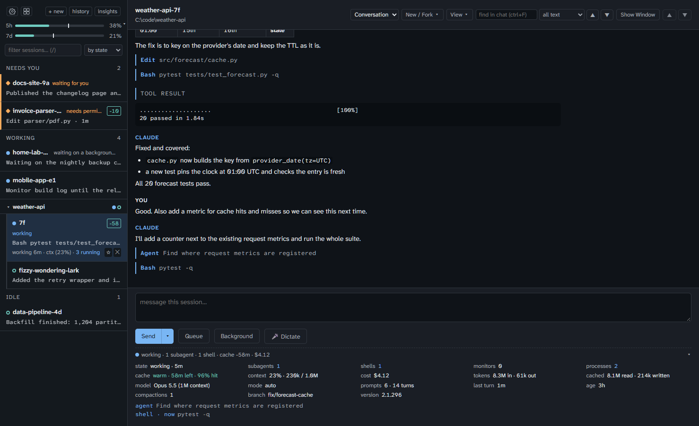
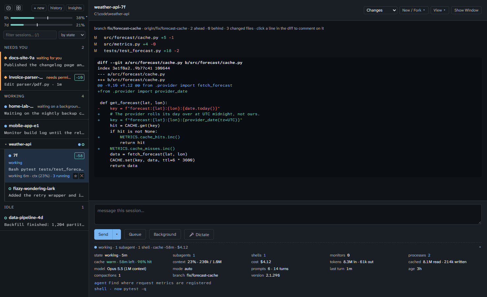
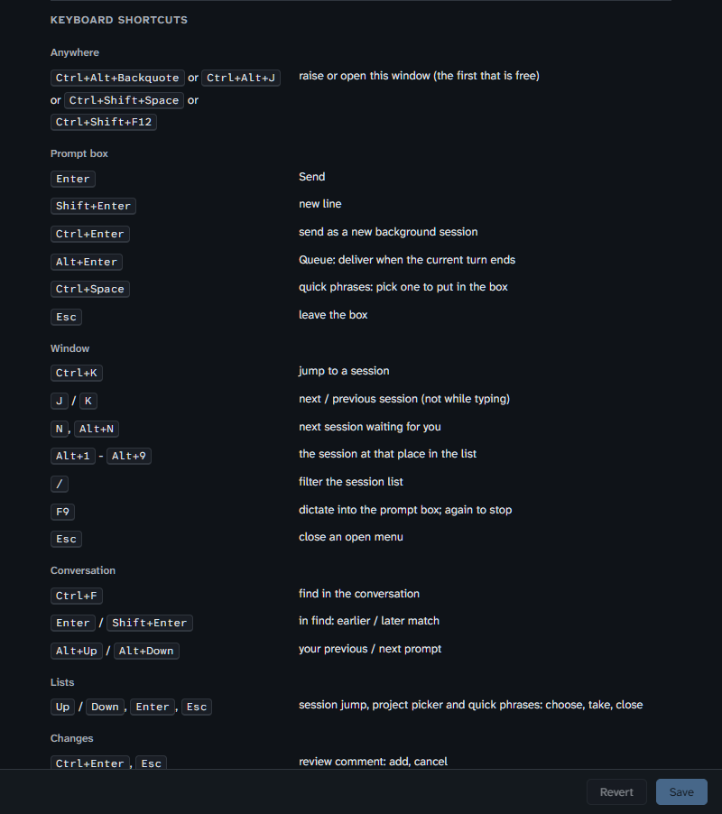
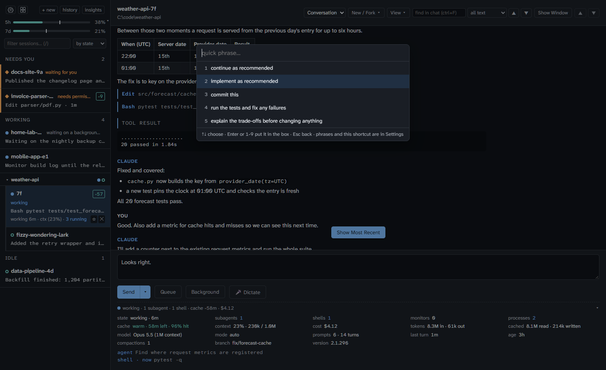
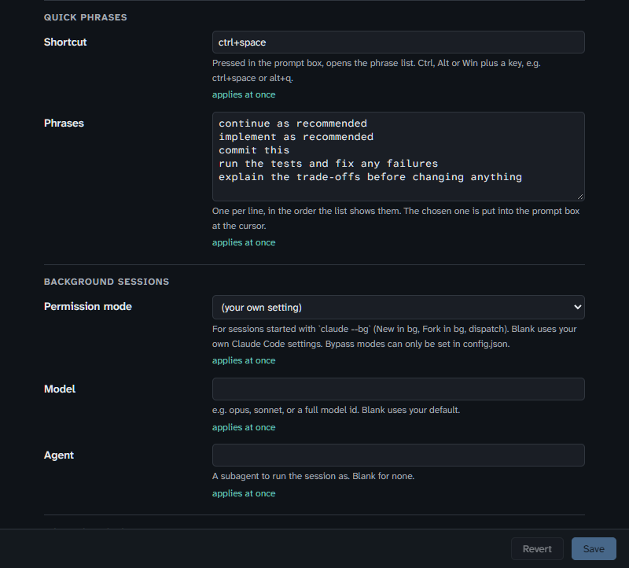

# Imperatorium

One place to see every Claude Code session on this machine and the machines
you reach over SSH, and one way to send work to any of them without hunting
for its window.

(Inside the code it is still `ccontrol` - "Central Control" - and so are the
scheduled tasks, service units and state folders it installs.)

Built for a desk running ~20 concurrent sessions across separate repositories,
spread over several Windows virtual desktops. The premise is that *finding the
window* is a symptom, not the problem: if you can dispatch without visiting a
session, and be told when one actually wants you, most of the hunting stops
being necessary.



*Sessions down the left, grouped by what they need from you; the selected session's conversation, prompt box and status panel on the right. (Demo data.)*

## Install

You need Python 3.9+, [Claude Code](https://claude.com/claude-code) 2.1.234+
(2.1.224 on macOS/Linux) and git. `gh`, Windows Terminal and Edge are
optional; each switches a feature on (PR badges, Resume/Fork tabs, a
chromeless window). [ONBOARDING.md](ONBOARDING.md) walks through the whole
thing step by step, including other machines.

**From nothing** - the bootstrap script checks the prerequisites, offers to
install what is missing (winget for Python and git on Windows, Anthropic's
installer for Claude Code), clones this repository into `~/imperatorium` and
runs the setup below:

```
# Windows (PowerShell)
irm https://raw.githubusercontent.com/hypertetrahedron/imperatorium/main/bootstrap.ps1 | iex

# Linux / macOS
curl -fsSL https://raw.githubusercontent.com/hypertetrahedron/imperatorium/main/bootstrap.sh | bash
```

**From a clone:**

```
git clone https://github.com/hypertetrahedron/imperatorium.git
cd imperatorium
python setup_machine.py
```

It asks where your projects live (default: the folder you cloned into) and
which extras you want (dictation, Stream Deck, auto-approval, statusline,
tool hooks, phone push, start at logon). Then it builds `.venv`, writes
`config.json` and `policy.json` from the `*.example.json` files, fetches the
Stream Deck driver and checks its hash, adds the hooks to
`~/.claude/settings.json` (backing it up first) and registers the service
that keeps the dispatcher up: scheduled tasks on Windows, a systemd user unit
on Linux, a launchd agent on macOS. Every step can be run again safely, and
your existing `config.json` and `policy.json` are never overwritten. Restart
running Claude Code sessions afterwards so they pick up the hooks.

```
python setup_machine.py check              # what is present and missing; changes nothing
python setup_machine.py --yes              # all defaults, no questions
python setup_machine.py uninstall          # hooks and the service; your files stay
python setup_machine.py service status     # install | uninstall | restart | status
python setup_machine.py remote add HOST    # onboard another machine (see "Other machines")
python setup_machine.py remote check       # every configured host, piece by piece
```

Hook paths point into this checkout, so if you move it, run the setup again.

## The window

```
python -m ccontrol.window      # chromeless, via Edge --app=
http://127.0.0.1:8792/         # or just open it
```

Sessions down the left, the selected session's conversation in the middle, a
prompt box underneath. Selecting a session shows what it actually said - text,
tool calls, tool results - so you can see what a blocked session is blocked on
instead of guessing from a status dot on another screen. What Claude writes
is rendered as Markdown - bold and italic, inline code, links, headings,
lists, quotes, code blocks and tables - by a small renderer in `ui.py`, not
a library, so the page still loads with no network. Enter sends to that
session; ctrl+Enter hands the work to a fresh background session. The prompt
box keeps an unsent draft per session (in this browser), so switching away
mid-sentence and back loses nothing.

The chat shows the whole conversation, back through every compaction - each
one, including those Claude Code runs on its own while a session sits idle,
is marked by a folded "compacted here" divider holding the summary it kept.
What you send from the window shows as yours ("via inbox") even when it
reached a session mid-turn. A long conversation draws its latest 60 turns
first, with **show earlier** above them (jumping up past the first one
draws more), and the last few sessions you viewed are kept in the page, so
switching back to one paints at once; the dispatcher parses a transcript
again only when it has changed. Claude Code's own messages - a background task
finishing, a slash command's output, a subagent's report - are captioned as
such rather than as you. A strip between the chat and the prompt box sets
how each kind of text shows - prompts, replies, thinking, tool calls, tool
results and Claude Code's own messages - as **Full**, **Compact** (one line,
click to open) or **Hidden**, remembered in that browser; at its right, ▲/▼
(alt+Up/Down) jump between your prompts. **Show Current Prompt** pins the
prompt the session is working on above the chat.

While the session is waiting on something, a drawer under the chat has a
tab for each running shell, Monitor and subagent. A shell's or Monitor's
tab shows the end of what it has printed. A subagent's tab shows what it
has said, a `> Tool what` line for each call it made and an `x` line for
each call that failed, read from its own transcript under the session's
`subagents/` folder. With several, an **Auto** tab comes first and follows
whichever wrote last. Drag the drawer's top edge to resize it.

Under the Send buttons, a status panel (click its line to fold it) shows the
selected session in more detail than its tile: subagents, backgrounded
commands and Monitors still running, the shell processes under it, whether
its prompt cache is still warm and for how long, context, cost and token
totals, model, permission mode, prompts and turns, age, compactions and
branch. Background work and the cache come from the session's transcript
(`ccontrol/sessionstat.py`, read incrementally), context from the
statusline, and cost and tokens from the transcripts: the whole session,
subagents included, estimated at API list prices (`ccontrol/costs.py`).

Spend comes in two parts, both read from the transcripts, so a restart loses
neither. **Global** is everything sent from this machine in the account's
windows: the 5-hour and 7-day windows on a Pro or Max subscription, the
calendar month on any other account. **Current sessions** is the sessions
open in Imperatorium, each over its whole life. The sidebar meter shows only
its bars until you click it; then it also shows both spend lines (the detail
is in their tooltips) and a **model mix**: a stacked bar for each window and
for the open sessions, splitting output tokens by model family (haiku,
sonnet, opus, fable, other) in cost order, after claude-lens's model mix
chart. Click again to fold it. The Chat Matrix's status tile starts with the
same bars and model mix, then shows both spend parts in full. Usage from claude.ai or other machines isn't
in these transcripts, so it shows only in the meters' percentages. The last
rate-limit reading is kept in `limits.json` beside the state file, so the
meters are back as soon as the dispatcher restarts.

Every local tile carries the same at a glance: `-58` is the minutes until
the prompt cache expires (gone once it has), and `0/2/1/0` counts subagents /
background shells / monitors / shell processes while the session's process
lives - anything but zeros means other work is in progress. Hover either for
the long form. The panel's line (the one left when it is folded) says the
cache the same way, `cache -58m`, and ends with the tile's totals.

Conversations are read through the Agent SDK: its private chain builder
gives the same message order the supported `get_session_messages` does, and
`conversation.py` then adds back the three things that reader drops - prompts
that arrived through the inbox, prompts folded into a running turn, and
everything before a compaction. Those reach into transcript fields the docs
call internal; if they move, the reader falls back to the public call and
only those additions go missing.

Tabs above the conversation show the session's **Changes** (git status and
diff), its **Activity** (every tool call, what failed and why) and the
project's **Worktrees** (the branches background sessions leave, with merge,
PR and discard). The header offers Fork, and Resume for a session that has
finished. **Queue** (alt+Enter) holds a prompt until the session's current
turn ends. The sidebar groups by state or folder, pins, archives and
filters; each tile says what the session is doing now, its context use and
its PR. A session between turns that still has a background command running
shows as working ("waiting on a background task"), not idle. The 5h and 7d
usage bars carry a tick showing how far through each window the clock is, and
a reset that is not today names its weekday. When a window resets, its bar
drops to 0% and waits there (the tip says so) until a session's status line
reports the new window. Only a claude.ai Pro or Max plan
has those windows (and a Claude apps gateway its spend limit); a session on
AWS Bedrock, Google Vertex AI, Microsoft Foundry, an API key or a gateway, or a
Team or Enterprise login, has none, so the space names the plan instead -
"AWS Bedrock" - and beside real bars it adds "also AWS Bedrock - no limits".
The statusline script reads the provider from the session's environment
(`CLAUDE_CODE_USE_BEDROCK` and the like), the model id is the fallback, and
the Team or Enterprise plan comes from `organizationType` in `~/.claude.json`.

A project with more than one session open gathers them under a node named
for the project, its tiles indented beneath it and named without the
project (`5b`, `fizzy-wondering-lark`). The node carries one dot per
session, so how many there are and what each is doing reads at a glance;
clicking it folds the family away and clicking again shows it all;
double-clicking hides only the sessions waiting for you (both remembered in
this browser). The family sits in the group of its most
urgent member. A session started in a worktree (`claude --worktree`, or
any linked worktree) counts as its repository's and carries a branch icon:
its made-up name `<worktree>-<id>` is shown as `<project>-<worktree>`,
while a name someone chose is kept. Grouped by folder, the list becomes that
tree outright: every project gets a node, even with one session.
On the Stream Deck the same session takes a key under its project's name.



*The Changes tab of the same session. (Demo data.)*

The gear at the top left of the sidebar opens **Settings**, a window of its
own for what you would otherwise edit in `config.json`: project folders,
Send As Typed, quick phrases, background-session options, notifications, usage alerts, dictation, remote
sessions, the palette hotkeys and the Stream Deck's pinned projects. Each
setting says when it takes effect; notifications, alert thresholds and
background options apply at once, the rest after the restart the window
names. A save checks every value first and changes nothing if one is wrong,
keeps the previous file as `config.json.bak`, and keeps its `_comment` keys.
Some things are left to `config.json` by design: the auto-approval rules
(`policy.json`), a bypass permission mode, the ntfy token, and adding or
removing remote hosts (`setup_machine.py remote add|remove`).
The bottom of the window lists every keyboard shortcut, with the ones you
can set showing their current keys.



*The shortcut list at the bottom of Settings. (Demo data.)*

**Quick phrases.** In the prompt box, the quick-phrase shortcut (Ctrl+Space
unless you change it) opens a list of your stock phrases - "implement as
recommended", "continue as recommended" and whatever else you add under
Quick phrases in Settings, one per line. Type to filter, then Enter, a
click, or 1-9 before typing puts the phrase into the box at the cursor;
nothing is sent until you send it. To set the shortcut, click its field and
press the keys; one the window already uses (Ctrl+Enter, Ctrl+K, Alt+1-9, ...)
is refused.



*Ctrl+Space in the prompt box. The phrases and the shortcut are set in Settings:*



Next to it, the grid icon opens the **Chat Matrix**, a window of
its own (click again to close it) with a tile for every running session.
The grid is whichever one makes 1-by-1.5 tiles biggest for the window's
size; the tiles then stretch to fill the window. Each holds only Claude's
replies, newest at the bottom with a dashed rule between turns (nothing
scrolls; older replies run off the top), and under them the one step in
flight: a tool call while it runs, or a thought while it lasts. A working
session with neither says what it is waiting on instead, such as
`waiting on 1 background shell · 1 process`.
Double-click a tile to show that session in the main window. Prompts, tool results and finished
steps are left out. A session waiting for you gets an amber border and says
why. When the grid has spare cells, they always come at the end and become
one status tile: the usage meters and model mix, what the open sessions
have cost and how many tokens they have used over their whole lives, this
machine's spend in each of the account's windows, and each session's
share. The
condensing is done by the dispatcher (`ccontrol/matrix.py`, `GET
/api/matrix`), so the page polls one small answer.

**Keys:** j/k move through the session list, n (or alt+N from anywhere)
goes to the next session waiting for you, alt+1-9 picks the nth tile, /
filters, and ctrl+K opens a palette to jump to any session by name. A
session that finished a turn while you were looking elsewhere carries a
**new** badge until you open it. The window's title counts the sessions
waiting for you, "(2) Imperatorium", and its tab icon takes the most urgent
state's colour and shape. A tile also warns `cold 178k` when a large context
sits behind an expired prompt cache, and the prompt box says so in words (and
when the context is nearly full). The session list arrives over server-sent
events (`/api/stream`), so a session asking for you shows at once; the page
falls back to polling if the stream drops.

**ctrl+F** (or the find box under the chat) searches the open conversation -
all text, tool calls only, or failed results only - and steps between
matches, newest first. In the **Changes** tab, click a line of the diff to
leave a comment on it; the comments go to the session as one prompt, or into
the prompt box to edit first.

**history** searches every past session; **insights** tallies tool
failures across projects, estimates what the last 7/30/90 days of tokens
would cost at API list prices (by day, project and model, from the
transcripts), and switches the phone, spoken and desktop alerts on.

## What it does

- **Registry** - every live session, its project, and whether it is idle,
  working, or blocked on you. A session between turns that still has a
  background command running (a build, a test run, a `Monitor`) shows as
  working - "waiting on a background task" - not idle, since it wakes when
  that command exits. Found by counting the shells under its `claude`
  process; background subagents run in-process and are not seen.
- **Attention** - Claude Code hooks push `permission_prompt`, `idle_prompt`
  and `agent_needs_input` here the moment they happen, so the board shows what
  is waiting and for how long.
- **Dispatch** - "project: laser ledger, implement the new feature as
  recommended" is matched to a project and delivered to that project's running
  session. With no session running, it opens one with the prompt pre-filled.
- **Board** - a self-contained page for a spare monitor or a tablet on the LAN.

## Requirements

Python 3.9+, standard library only. Claude Code 2.1.234 or later on native
Windows (2.1.224 on macOS/Linux) - that is when a session's inbox became
reachable. The optional Stream Deck surface has its own dependencies and is
kept separate for that reason.

## Running it

`impctl.py` is the one front door: service control, sessions, approvals,
setup and tests, without having to know which file each lives in.
`impctl.ps1` and `impctl.sh` run it from any folder with the right Python
(the venv when there is one): `.\impctl.ps1 status`, `./impctl.sh status`.

```
python impctl.py help                      # every command and its parameters
python impctl.py help send                 # one command in full
python impctl.py status                    # service components, and is the dispatcher up
python impctl.py restart [dispatcher]      # stop then start (all, or one component)
python impctl.py stop | start [COMPONENT]  # stop stays stopped: the task is disabled
python impctl.py sessions                  # live sessions
python impctl.py send -s NAME "prompt"     # or -p PROJECT; --dry-run to see the route
python impctl.py resume | fork | new ID    # sessions by id, id prefix or name
python impctl.py pending; python impctl.py allow ID
python impctl.py test                      # every suite, through the venv if there is one
```

The pieces underneath, run directly:

```
python -m ccontrol.dispatcher              # http://127.0.0.1:8792
python hooks/install.py --dry-run          # show what would change
python hooks/install.py                    # install the hooks (backs up first)
python hooks/install.py --statusline       # + usage meter data (context, 5h/7d limits)
python hooks/install.py --tool-hooks       # + live, timed activity (one process per tool call)
python test_core.py && python test_dispatcher.py
python test_policy.py && python test_remote.py && python test_conversation.py
python test_hotkey.py && python test_ui.py        # test_ui needs node; skips without
.venv\Scripts\python.exe test_streamdeck.py        # needs the venv
.venv\Scripts\python.exe test_voice.py
.venv\Scripts\python.exe test_features.py        # the newer tabs, queue, usage, history
python test_setup.py                               # the installer
python test_impctl.py                              # the command line
python test_convcache.py && python test_sessionstat.py  # conversation cache, status panel
python test_costs.py                               # cost history
python test_settings.py && python test_quick.py    # Settings window, quick phrases
python test_closing.py && python test_slash.py     # closing a session, typed commands
python test_matrix.py && python test_taskout.py    # Chat Matrix, task output
# 936 tests in total
```

Individual pieces are runnable on their own, which is usually the fastest way
to see what is wrong:

```
python -m ccontrol.registry                            # what is running
python -m ccontrol.projects "project: gem trip, fix it" # what would it match
python -m ccontrol.deeplink Y:/projects-software/gem-trip "fix it"
```

## HTTP surface

| Method | Path | Purpose |
|---|---|---|
| GET | `/` | the window |
| GET | `/api/conversation` | `?session=<id>&limit=N` - what a session said |
| GET | `/api/sessions` | merged registry |
| GET | `/api/stream` | server-sent events: the merged registry whenever it changes |
| GET | `/api/projects` | the project catalogue |
| GET | `/api/events` | recent attention events |
| GET | `/api/decisions` | recent auto-approval verdicts |
| GET | `/api/hosts` | configured hosts and their reachability |
| GET | `/api/health` | liveness |
| POST | `/hook` | Claude Code hook events |
| POST | `/api/transcribe` | raw audio in, text out |
| POST | `/api/voice/warm` | `{}` - start the dictation process now (the mic was pressed) |
| POST | `/api/focus` | `{project}` or `{session_id}` - raise that session, or open one |
| POST | `/api/dispatch` | `{text}` or `{project, prompt}`, plus `mode`, `confirm`; a prompt starting with `/` is typed at the session's prompt instead (see below) |
| POST | `/api/typed` | `{session_id, prompt}` - Send As Typed; only from the window (its Origin and token), and only when turned on in Settings |
| GET | `/api/changes` | `?session=` - branch, changed files, diff against HEAD |
| GET | `/api/activity` | `?session=` - tool-call timeline and counts |
| GET | `/api/session_status` | `?session=` - background work, prompt cache, tokens and cost (the status panel) |
| GET | `/api/awaited` | `?session=` - the end of what each running shell and Monitor has printed, and what each running subagent has said and called (the process drawer) |
| GET | `/api/worktrees` | `?project=` - linked worktrees, ahead/behind/dirty |
| GET | `/api/worktree_diff` | `?project=&path=` - what a worktree's branch would bring |
| POST | `/api/worktree` | `{project, path, action: merge\|pr\|discard, force}` |
| GET | `/api/history` | `?q=` - search past sessions |
| POST | `/api/resume` | `{session_id, where: window\|background, fork, prompt}` |
| POST | `/api/new` | `{session_id, cwd, close}` - a fresh session in that project, in a new tab; answers its `session_id`. With `close`, the old session is then ended (typed `/exit`, killed if it stays) |
| POST | `/api/close` | `{session_id}` - end a running local session and its terminal tab |
| GET/POST | `/api/queue`, `/api/unqueue` | prompts held until a session's turn ends |
| GET | `/matrix` | the Chat Matrix window |
| GET | `/settings` | the Settings window |
| GET | `/api/quick` | the quick-phrase shortcut and phrases, for the prompt box |
| GET/POST | `/api/settings` | the settings form; POST `{changes: {key: value}}` checks them all, writes `config.json` (old copy in `.bak`) and applies what it can at once |
| GET | `/api/matrix` | every running session's replies and current step, plus total spend |
| GET | `/api/usage` | rate-limit windows and their pace (needs the statusline; the last reading survives a restart), plus `spend`: global and current-session tokens and estimated cost |
| GET | `/api/errors` | `?days=` - tool failures by cause, tool and project |
| GET | `/api/costs` | `?days=` - estimated cost by day, project and model, from transcripts |
| GET/POST | `/api/prefs` | pinned, archived, grouping |
| GET/POST | `/api/notify` | ntfy and speech channels, on/off |
| GET | `/api/pending` | parked permission requests; `POST /api/decide` answers one |

`mode` is `auto` (inject if a session is live, else launch), `inject`, `launch`,
`background`, or `dry-run`.

`background` runs `claude --bg` in the project instead of opening a window -
work you want done rather than a window you want to sit in. Claude Code
isolates it in a worktree and commits on delete by itself. It still reports
through the same hooks, so it shows on the board and turns its key orange if
it gets blocked. Options for it live under `background` in `config.json`.

Bound to `127.0.0.1`. POSTs must be JSON and must carry no `Origin` header: a
cross-origin `fetch` with a plain-text body is a CORS "simple request", so a
page you merely had open could otherwise drive this.

## How dispatch actually works

Claude Code binds an inbox for each session - a named pipe on Windows, a Unix
socket elsewhere - and exports its path and a per-session token to that
session's hooks and Bash children. Writing two JSON lines to that pipe puts a
message in the session:

```
{"type":"auth","token":"<CLAUDE_CODE_MESSAGING_TOKEN>"}
{"type":"user","message":{"role":"user","content":"..."}}
```

The auth line is mandatory on native Windows; a connection whose first line is
not a valid auth line is closed and delivers nothing.

**A dispatched message is not you.** It arrives as a peer message, and Claude
Code is explicit that such a message is not user consent: it cannot answer a
pending permission prompt, cannot change settings or `CLAUDE.md`, and a slash
command in its text arrives as inert text. What the token buys is delivery
*without an approval dialog*, not authority.

**Slash commands are typed, not sent.** Because an inbox message cannot run a
command, a chat message that starts with `/` (`/compact`, `/clear`,
`/model opus`, a skill's command) is instead typed at the session's prompt
through its console, the way `/exit` is typed to close a session. That is
real terminal input, so it only happens when the session is idle at its
prompt with no permission decision parked for it - Enter would otherwise
answer the dialog. A draft at the prompt is cleared first. Commands that open
a menu in the terminal (`/config`, `/permissions`, `/model` with no
argument, ...) are refused, since the window cannot drive the menu. Queued, a
command is typed when the turn ends. Local Windows sessions only for now.

**Send As Typed** (the arrow beside Send) does the same for an ordinary
prompt, so it arrives as you typing at that terminal rather than as a peer -
it can approve what a sent message cannot, such as spending a budget. The
text is made one line (line breaks become spaces, control characters go, a
leading `!` or `#` is dropped so it cannot switch the input mode). It is off
until you turn it on in Settings, under Chat, and only the window can use it
or turn it on: the request must come from the page's own origin with the
token the page was served with. That keeps `impctl`, scripts and other
sessions from typing as you by accident; it is not a wall against a process
on this machine that sets out to forge it.

Claude Code also tells the receiving agent the message came from "another
Claude session" and to answer by `SendMessage` to its sender - but a
dispatched prompt has no sender. With two sessions open in one project, an
agent answered a window prompt by messaging the other session. So every
dispatched prompt starts with one line saying there is no sending session and
to reply in its own conversation (`conversation.ORIGIN_NOTE`); the window and
the event log strip it again. So this dispatches work; approving
what that work then asks for stays a human job, through the terminal, Remote
Control, or a `PermissionRequest` hook.

A token is only valid for the inbox it was recorded against. A resumed
session keeps its id but binds a new pipe, so the store hands out the socket
and token together and a token is honoured only while its socket still
matches; a mismatch shows up as `stale_credential` and dispatch falls back to
opening a window instead. Since `SessionStart` fires only once, every hook
event carries the credential, so a session that was already running when the
dispatcher started is repaired by its next `Stop` or `Notification` rather
than staying unreachable until it is resumed.

The token is the constraint that shapes the design. Claude Code hands it to
hooks and nowhere else, which is why `SessionStart` has to be a `command` hook
that reads its own environment, and why the store persists tokens: forget one
and that session is unreachable until it restarts.

## Matching

A wrong match here does not garble text, it fires a prompt at the wrong
repository. So `resolve` reports a confidence and only `certain` is acted on
silently; anything less needs `confirm`. On this machine that correctly lands
`book of errant pages` on `bookoferrantpages` and a slurred `amaranth a` on
`amarantha`, while refusing `home assistant`, which is not a project here.

## The hotkey

`hotkey.py` is all that remains of the old palette: it registers a global
hotkey and raises the window from anywhere, opening one if none is running.
It finds the window by title, so `ui.render_shell`'s `<title>` and
`hotkey.WINDOW_TITLE` have to agree - a test pins that, because otherwise a
press silently opens a second window instead of raising the first.

Conflicts are the norm rather than the exception (`ctrl+alt+space` and `win+k`
were both already taken here), so `palette.hotkey` in `config.json` takes a
list and the first candidate Windows grants wins.

## Dictation

**f9**, or the Dictate button, starts and stops recording; the text lands in
the prompt box. The browser records and a dictation process beside the
dispatcher decodes and transcribes, so nothing leaves the machine.

Voice fills the *prompt*, never the project. Project names here -
`laser-ledger`, `amarantha`, `bookoferrantpages`, `fiducials` - are close to a
worst case for speech recognition, and a misheard name would not garble text,
it would fire a prompt at the wrong repository. Picking from the list costs a
keystroke and removes that failure completely, leaving speech to do what it is
good at: roughly 150 words a minute against 50 typed.

Measured on this machine with `large-v3-turbo` at float16: 3.1s to load the
model, then about 0.09s to transcribe five seconds of speech.

With no usable GPU (none, or no CUDA runtime) the model is loaded on the
CPU instead, at int8, and as `voice.cpu_model` (default `small`) rather
than `voice.model`: `large-v3-turbo` on a CPU makes every dictation a wait.
A config that names a model other than the default but sets no `cpu_model`
keeps that model on the CPU. `"device": "cpu"` goes straight there. The Say
Line then reads "listening on CPU (small)…" and "dictated N chars on CPU
(small)", so a slow dictation explains itself. On this machine, a
six-second sentence: `small` on the CPU loaded in 6.1 s and transcribed in
1.9 s; `large-v3-turbo` on the CPU took 8.0 s and 6.7 s; on the GPU, 4.0 s
and 0.5 s (first call after loading). All three got the sentence right.

The model lives in its own child process, not in the dispatcher: with the
CUDA runtime it takes a process to ~3.3 GB of private memory (plus ~2 GB of
VRAM), and only ending the process gives all of that back. With
`voice.preload` (the default) it starts with the dispatcher; after
`voice.idle_unload` seconds without dictation (default 1800, 0 for never) it
is ended, and pressing Dictate starts it again while you speak - a cold start
is 3-4 s, mostly hidden behind the speaking. Only a config with a `voice`
block turns dictation on.

Near-silence returns nothing without ever calling the model - Whisper will
happily invent words for a fumbled keypress.

The microphone is now the browser's, so it follows Windows' default input
device and its own permission prompt rather than `voice.input_device` - that
setting only applies to the headless `Recorder`, which nothing currently uses.
Dictation needs the venv (`faster-whisper`, PyAV); without it the window runs
as before and the button reports that it is unavailable.

## Stream Deck

`streamdeck_surface.py` puts one session on each key, coloured by what it is
doing: orange blocked, blue working, green idle, grey no session. A project
with several sessions gets a key for each, with a `1/2` counter in the
corner. A blocked key carries a badge counting how long it has been waiting,
and a key whose session changes state flashes between its old and new
colours for five seconds. Pressing a key raises that exact session, or opens
one if nothing is running.

```
.venv\Scripts\python.exe streamdeck_surface.py
```

It is a separate process with its own dependencies (`streamdeck`, `pillow`),
so the dispatcher stays standard-library only, and it holds no state - killing
or restarting it affects nothing else. Pin the projects you want in fixed
positions under `streamdeck.keys` in `config.json` - each expands into one
key per session, and keeps a grey key while nothing runs there. Every other
open session fills the remaining keys, blocked first. When keys run short,
the grey keys give way first. Remote sessions stay off the deck: a press has
no window here to raise.

The library's only backend is hidapi, which is not on PyPI, so the official
libusb release DLL is vendored at `vendor/hidapi.dll`. The venv's `python.exe`
is a uv shim, so its directory is not on the DLL search path and the surface
registers the vendor directory with `os.add_dll_directory` at import.

## Layout

The parts of the window itself are named in
[docs/ui-names.md](docs/ui-names.md). Use those names when talking about
the UI.

```
ccontrol/registry.py    who is running, from `claude agents --json`
ccontrol/procs.py       is an idle session still waiting on a shell it started
ccontrol/projects.py    the catalogue, and turning speech into a project
ccontrol/inbox.py       the named-pipe client
ccontrol/deeplink.py    claude-cli://open URLs
ccontrol/background.py  handing work to `claude --bg`
ccontrol/voice.py       dictation, on the local GPU, in a child process
ccontrol/remote.py      sessions on other machines: polling, injection, tunnels, reading
ccontrol/store.py       tokens and events that outlive a restart
ccontrol/dispatcher.py  the HTTP server and the routing decisions
ccontrol/ui.py          the window: sidebar, conversation, prompt
ccontrol/fonts/         Atkinson Hyperlegible Next and Mono, served to the window
ccontrol/matrix.py      the Chat Matrix: replies and the step in flight, and spend
ccontrol/closing.py     ending a session cleanly, so its terminal tab closes
ccontrol/conversation.py  session messages, ready to render
ccontrol/convcache.py   parsed conversations, reread only when a transcript changes
ccontrol/sessionstat.py background work, prompt cache and tokens, from the transcript
ccontrol/taskout.py     what awaited shells, Monitors and subagents have written
ccontrol/window.py      opening it chromeless
ccontrol/policy.py      what may be auto-approved, and what may not
ccontrol/winfocus.py    raising a session's window, by process id
ccontrol/changes.py     git status/diff, and background-session worktrees
ccontrol/activity.py    tool-call timelines, "doing" lines, failure tallies
ccontrol/history.py     searching past sessions; resume and fork
ccontrol/usage.py       statusline readings, rate-limit pace, thresholds
ccontrol/costs.py       estimated cost history from transcripts, at list prices
ccontrol/prs.py         the PR for a session's branch, off the request path
ccontrol/notify.py      ntfy pushes and spoken alerts (both off by default)
setup_machine.py        installing on a new machine; check; uninstall;
                        onboarding other machines; the service
bootstrap.ps1/.sh       from nothing: prerequisites, clone, setup
ONBOARDING.md           the step-by-step walkthrough
*.example.json          what config.json and policy.json start from
requirements*.txt       core, voice and Stream Deck dependencies
hooks/cc_statusline.py  the statusline: forwards usage, prints a short line
impctl.py               the command line: every function below, and a help
impctl.ps1/.sh          run it from anywhere, with the venv's Python
hotkey.py               the global hotkey, and nothing else
streamdeck_surface.py   the Stream Deck, a separate process
service/tasks.ps1       Windows scheduled tasks that keep all three up
hooks/                  the hook, and an installer for user settings
```

Runtime state lives in `%LOCALAPPDATA%\ccontrol\state.json` on Windows
(`$XDG_STATE_HOME/ccontrol`, or `~/.local/state/ccontrol`, elsewhere), not
beside the source: a checkout on a mapped network drive is common, and
Windows refuses an atomic rename-over on SMB often enough to matter for a
file holding tokens.

## Other machines

Hosts listed under `remote` in `config.json` are polled over SSH with the same
`claude agents --json` that answers locally, so a host needs no agent, no
daemon and no open port - just a key you already use. Their sessions appear on
the board tagged with the host.

```
python -m ccontrol.remote                  # probe the configured hosts
python -m ccontrol.remote somehost         # probe one by name
```

The same SSH call reads the host's `~/.claude/sessions/*.json`, which is where
local rows get their status and inbox path, so a remote row says idle, busy or
waiting just as a local one does.

### Adding a host

```
python setup_machine.py remote add HOST            # user@host or an ~/.ssh/config alias
python setup_machine.py remote add HOST --label pi --no-reader
python setup_machine.py remote check               # what each host has and lacks
python setup_machine.py remote remove HOST [--purge]
```

`remote add` walks through everything a host needs, and each step is safe to
repeat:

1. **SSH key login.** If a password-less login fails it offers to create a
   key (`ssh-keygen`) and copy it across - you type the host's password once.
2. **Claude Code** 2.1.224+ there, found by absolute path. If it is missing or
   old it offers Anthropic's installer (`--install-claude` to skip the
   question). Log in once on the host afterwards.
3. **python3** there, which the hooks and prompt delivery use.
4. **The conversation reader** - the Agent SDK in `~/.claude/ccontrol/venv`,
   ~300MB, so the window can show that host's conversations. `--no-reader`
   skips it.
5. **The reporting hooks**, in the host's `~/.claude/settings.json` (backed
   up first), unless `--no-tunnel`.
6. **config.json**: the host entry with `"tunnel": true`, then a dispatcher
   restart.

The pieces are described below, and can still be done by hand
(`python hooks/install.py --remote HOST [--dry-run|--uninstall]`).

### Making a host as controllable as a local session

Two more things make a remote session reachable, and neither needs a daemon on
the host or an open port on either machine:

- **Hooks, through a reverse tunnel.** The dispatcher holds `ssh -N -R` open
  to each tunnelled host, so `127.0.0.1:8792` on the host leads back here and
  the host runs the same `cc_hook.py`. That is what delivers attention
  (permission prompts, failed turns) and, above all, the session's inbox
  token, which Claude Code hands to hooks and nowhere else.
- **Injection, over SSH.** A prompt for a remote session is piped over SSH to
  a one-line `python3` writer that connects to its Unix socket. The token
  travels on stdin, never on a command line the host's `ps` could show.

The tunnel does **not** land on the dispatcher's own port. It lands on a
hook-only listener, one local port per host (8793 upward), which answers
`/hook` and nothing else - otherwise every process on that host could call
`/api/dispatch` into the sessions on this machine. The host an event came from
is known from which listener it arrived at, never from the payload, and its
records are stored under host-qualified keys, so a host can describe only its
own sessions. The tunnel's `ssh` is bound to the dispatcher with a job object,
so killing the dispatcher cannot orphan it holding the host's port.

With that in place, a remote project dispatches like a local one: into its live
session if one has reported in, otherwise into a fresh `claude --bg` there.
Focus still does not cross the wire - there is no window here to raise.

**Conversations** are read on the host, because that is where the transcript
is. The dispatcher keeps one SSH channel per host open and sends it this
project's own `conversation.py`, so a remote pane is built by exactly the same
code as a local one. The host needs the Agent SDK in a venv, which
`remote add` installs (the interpreter is `reader_python` in `config.json`,
default `$HOME/.claude/ccontrol/venv/bin/python`).

A new connection per 1.5s poll would pay the SSH connect and the SDK's
one-off first read (~1s on a Pi) every time; on a kept channel a read is
~10-20ms. The channel dies with the dispatcher, and a host that fails is not
re-dialled for 30 seconds.

Remote projects are host-qualified - `developmenthost1/bookoferrantpages` -
because that name also exists locally, and firing at the wrong machine is the
same class of mistake as firing at the wrong repository.

Polling runs on its own thread every 20 seconds and never on the request path.
A host that fails is parked with a growing backoff and its real reason, so a
machine that is asleep costs nothing and never hides a working one. `claude` is
called by absolute path: it is not on PATH for a non-interactive SSH session on
Ubuntu, because `.bashrc` returns early.

## Auto-approval

At twenty sessions the bottleneck is not how fast agents work, it is how often
they stop to ask. `hooks/cc_permission.py` answers the cheap asks - reading a
file inside the project, `git status`, `pytest` - and forwards everything else
to you unchanged.

The rule that shapes it: **this removes prompts, never answers.** Anything not
provably cheap becomes `ask`, which is exactly the prompt you would have had,
so you keep the power to approve it. Refusing `git push` and `rm -rf` outright
was the first design and it was wrong - it took away the ability to say yes.

`deny` is reserved for one class: an agent changing the machinery that decides
what it is allowed to do - `settings.json`, `policy.json`, the hook scripts,
`policy.py`, or `--dangerously-skip-permissions`. There is no legitimate
mid-task reason to touch those, and the risk is an agent widening its own
authority. Secrets (`.env`, `id_rsa`, `.aws/`, `*.pem`) are never
auto-approved, but they are asked about rather than refused: you may have good
reason to let Claude read one.

Configure in `policy.json`; `"enabled": false` turns it off without touching
hooks. Per-project keys are `auto_edit`, `allow_reads_outside_cwd`,
`safe_bash` and `never_auto_approve`, and the most specific matching project
path wins. Every verdict lands in `%LOCALAPPDATA%\ccontrol\decisions.jsonl`
and on the board, so it is never a black box.

The hook does no network I/O at all - it is on the critical path of every
prompt, so it must not depend on the dispatcher being up. Silence means "ask",
which is what every failure path does.

**Until `"decision_format": "object"` is set in `policy.json`, none of this
takes effect.** Claude Code reads the reply's `decision` as an object,
`{"behavior": "allow"}`; the hook's original reply sent a bare string, which
is ignored. The documented shape is implemented but switched off, so that
turning auto-approval on is a choice rather than a side effect of a bug fix.
The same switch is what lets an answer from the window's Allow/Deny banner or
the Stream Deck's decision keys reach the session (with `park.enabled`).

## Keep it running

`setup_machine.py` registers this for you; `python setup_machine.py service
install|uninstall|restart|status` does it again on its own.

- **Windows:** three scheduled tasks, per-user, no elevation - the
  dispatcher, the Stream Deck and the hotkey (`CentralControl*`).
- **Linux:** systemd user units, `ccontrol-dispatcher.service` (and
  `ccontrol-streamdeck.service`), `Restart=always`. A user unit stops at
  logout unless you run `loginctl enable-linger $USER`.
- **macOS:** launchd agents, `local.ccontrol.dispatcher` (and
  `.streamdeck`), `KeepAlive`, logging to `~/Library/Logs/ccontrol-*.log`.

The Windows tasks can also be driven directly:

```
powershell -ExecutionPolicy Bypass -File service\tasks.ps1 -Action status
powershell -ExecutionPolicy Bypass -File service\tasks.ps1 -Action install
powershell -ExecutionPolicy Bypass -File service\tasks.ps1 -Action restart
powershell -ExecutionPolicy Bypass -File service\tasks.ps1 -Action uninstall
```

The dispatcher has to outlive any single Claude Code session: started from a
session's shell it is a child of that session and dies with it, taking the
board and the Stream Deck with it.

Two things about Task Scheduler are worth knowing before changing this.
`RestartCount` does not bring back a process that was *killed* - the task
records `0xFFFFFFFF`, goes to Ready, and schedules nothing. And a repetition
attached to the logon trigger never fires again, because that trigger's window
opened at logon. What actually self-heals is a second `-Once` trigger starting
immediately and repeating every minute, with `MultipleInstances=IgnoreNew` so
each repeat is discarded for free while the task is running. Measured
recovery after a force-kill: about 20 seconds.

## Deliberately not built

Worktree isolation and mobile steering are first-party now (`claude --bg`,
`claude remote-control`); what is here is the part they leave to you - seeing
and finishing a background session's worktree, and a push that only fires if
a session is still waiting a minute later. See `ROADMAP.md` for what was
surveyed and rejected, and why.

## License

MIT - see [LICENSE](LICENSE). The bundled fonts in `ccontrol/fonts/` are Atkinson Hyperlegible
Next and Mono, under the SIL Open Font License 1.1 (licence files alongside them).
